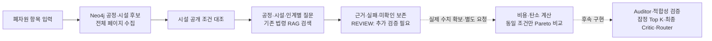

# 후보별 조사와 비용·탄소 계산

## 지금 새로 되는 일

이전에는 KG 조회와 법령 RAG 검색을 각각 호출해야 했습니다.
이제 **`POST /analysis/research` 한 번으로 공정·시설 경로의 모든 페이지를 모으고,
각 후보의 공개 시설 조건과 법령 조사 과제를 연결**합니다.



이 그림의 점선은 자동으로 연결되어 있지 않습니다. 목표 설계에서는 **적합성 검증이
비용·탄소 최적화보다 먼저**입니다. 현재의 별도 수치 API는 자료가 들어왔을 때 계산을
시험할 수 있는 도구이며, 검증 전 후보를 최종 추천하는 지름길이 아닙니다.

KG 조회 대상은 현재 별도 공정 전이·시설 DB에서 생성한 조합입니다.
W2RKG 원문 전체를 다시 조사하거나 국내 전체 사업장을 탐색하는 실행기는 아닙니다.
후보 수가 적어도 늘려 만들지 않습니다.

## 1. 실제 KG 후보에 법령 조사 붙이기

AI 서비스는 기존처럼 `Re_server`를 통해 호출합니다. 내부 호출 예시입니다.

```json
{
  "lot": {
    "material": "PP",
    "input_form": "scrap",
    "quantity_kg": 3000,
    "color": "검정",
    "page_size": 1
  },
  "max_pages": 20,
  "max_legal_queries": 24,
  "legal_top_k": 3
}
```

`POST /analysis/research`가 하는 일:

1. 기존 `/kg/assessed-plans` 서비스를 모든 페이지에서 호출합니다.
2. 같은 그래프 세대·후보 건수인지 확인합니다. 다른 세대가 섞이거나 후보·조건 대조 목록이
   다르면 전체 요청을 실패시킵니다. 기본 조회 1페이지를 전체 후보로 오해하지 않습니다.
3. 각 공정에 폐기물 분류·처리기준/예외·시설 허가·인계 책임 질문을 붙입니다.
   같은 질문은 실행 안에서 한 번만 검색합니다. 인계 질문은 해당 구간 ID에 연결합니다.
4. 기존 로컬 RAG를 호출하고 원문·조문·URL·시행일·검색 방법을 연결합니다.
5. 검색 결과 없음, 검색 서비스 오류, 검색 예산 초과도 각각 남깁니다.
6. **모든 후보와 미확인을 보존한 채 `REVIEW`로 반환**합니다. 공개 조건 불일치 후보도
   목록에서 삭제하지 않습니다.

응답에서 볼 부분:

| 항목 | 뜻 |
| --- | --- |
| `coverage.collected_candidates` / `enumerated_in_graph` | 받은 후보 수 / 현재 KG가 열거한 수 |
| `all_pages_read` | 응답 페이지를 끝까지 읽었는지 |
| `all_paths_enumerated_within_curated_scope` | KG 자체의 깊이·탐색 한도에 걸리지 않았는지 |
| `complete_within_curated_scope` | 위 두 범위를 모두 충족했는지. 전국 모든 시설 포괄이라는 뜻은 아님 |
| `legal_tasks` | 공정 또는 인계 구간에 붙은 질문·검색 ID |
| `legal_searches` | 공유 검색 결과와 `retrieved / no_hits / unavailable / budget_exhausted` |
| `facility_assessment` | 기존 시설 공개 조건 대조·단계별 확인 과제 |
| `blockers` | 검색 실패·허가/인수 미확인·적용성 검증 미완료 등 |
| `graph_trace` / `request_sha256` | 읽은 그래프 세대와 요청 추적 값 |

공식 도메인 여부·시행일 미상·미래 시행·법령 외 문서는 확인 표식을 붙입니다.
이 형식 검사나 검색 성공이 법규 적용성·허가 검증은 아닙니다. 항상
`applicability=not_audited`, `legal_audit_complete=false`입니다.
검색 원문이나 질문을 외부 생성 모델로 전송하지 않습니다.

현재는 요청 중 동기 실행하며 실행 이력을 DB에 영구 저장하지 않습니다.
페이지 한도에 걸리면 불완전 범위와 커서가 표시됩니다. 이 API는 중간 커서부터 분석을
재개하지 않으므로 처음부터 충분한 `page_size`와 `max_pages`로 다시 호출합니다.

## 2. 비용·탄소 수치 비교

`POST /analysis/compare-scenarios`는 **제출된 시나리오의 산술·누락·비교 기준**을 검사합니다.
현재 KG 경로의 적합성을 재검증하거나 실제 견적·LCI 숫자를 찾는 API는 아닙니다.

- 활동량 × 단가/배출계수를 `Decimal`로 계산합니다. 매각 수익만 순비용에서 뺍니다.
- 공정마다 처리 비용·탄소가 있어야 합니다.
- 배출지→첫 시설의 `후보ID:origin-transport`와 모든 인계 구간의 운송 비용·탄소가 필요합니다.
- 후보 전체의 잔재물 처리 비용·탄소와 매각 수익도 명시해야 합니다. 0이어도 근거를 붙입니다.
- 활동량·계수 양쪽 근거 ID, URL·원문 위치·유효기간·지역·연도를 받습니다.
- 입력 물량·기능단위·평가 시점·연도·지역·탄소 방법·경계가 맞아야 비교합니다.
- `KRW/t` 계수를 `kg` 활동량에 곱하는 식의 단위 오류를 막습니다. 단위는 자동 추정·환산하지 않습니다.
- 빠진 항목·기간 지난 근거·중복 ID·다른 경로 대상·다른 탄소 방법은 문제로 반환합니다.
- 일부 금액만 있으면 `known_*_subtotal`로 표시하고 전체 합계는 `null`로 남깁니다.

경계는 **같은 입력 폐기물 물량의 처리 → 산출물 출하 지점**입니다. 공정·초기/중간 운송·잔재물을
포함하고, 버진 자원 대체·회피 배출 공제는 포함하지 않습니다. 현재 다른 경계·배분 방법은
입력할 수 없습니다. 복잡한 배분·물질수지·가격/수율 불확실성은 별도 검수가 필요합니다.

비교 가능한 시나리오만 Pareto 층으로 나눕니다. 비용과 탄소가 서로 상충하면 같은 첫 집합에
남을 수 있습니다. 임의 가중치나 사용자 우선순위를 만들지 않습니다. **Pareto 층은 잠정
Top K·최종 추천이 아니며**, `final_recommendations`는 비어 있습니다.

원문을 읽어 가격·계수의 내용과 적용성을 확인한 것은 아닙니다.
제출된 URL·유효기간·사업장/공정 ID도 제출자의 주장입니다. 값을 넣었다고
`constraint_feasible`이나 현장 적용 가능한 경로로 바뀌지 않습니다.

### 실행 가능한 가상 예제

[scenario_comparison_demo.json](../data/config/scenario_comparison_demo.json)은 **활동량·가격·배출계수를
모두 지어낸 계산 테스트**입니다. 실제 업체·견적·LCI·공장 검증 자료가 아닙니다.

```bash
curl -X POST http://127.0.0.1:8000/analysis/compare-scenarios \
  -H 'Content-Type: application/json' \
  --data-binary @data/config/scenario_comparison_demo.json
```

테스트 기대값:

| 가상 시나리오 | 순비용 | 탄소 | 수치상 비교 |
| --- | ---: | ---: | --- |
| A | -210,000원 | 753 kgCO₂e | 첫 Pareto 집합 |
| B | 90,000원 | 453 kgCO₂e | 첫 Pareto 집합 |
| C | 90,000원 | 1,053 kgCO₂e | A·B보다 불리한 다음 집합 |

이 예제는 `mode=simulation`과 근거별 `synthetic=true`를 사용합니다.
`submitted_evidence` 모드에 가상 근거를 그대로 넣으면 비교에서 빠집니다.
실제 근거 모드도 원문의 진위를 자동 보장하지 않습니다.

## 3. 남은 데이터와 기술

| 구분 | 아직 필요한 것 |
| --- | --- |
| 데이터 | 사업장별 현행 허가·투입 규격·해당 로트 인수·수탁 가능 물량·견적·도로 운송 경로·단계별 물질수지·사용 가능한 LCI/배출계수 |
| 검증 | 법규 적용 사실·예외·원문 Auditor, 검수된 필수조건 규칙, 가격·계수·수율의 내용·적용 범위 검증 |
| 실행 | 적합 후보의 실제 수치 수집→계산 연결, 잠정 Top K, 전체 후보를 보는 독립 Critic, 원인 단계 재실행과 후속 결과 무효화 |
| 서비스 | 자연어·문서 추출·사용자 검수, 실행 이력·진행 이벤트·시간 제한, Re_server·3D·최종 보고서 연동 |
| 평가 | 현장·전문가가 검수한 실제 정답 사례. 현재 가상 입력 회귀 검사를 추천 정확도로 해석하지 않음 |

## 검증 실행

```bash
pytest tests/unit/test_candidate_research.py tests/unit/test_scenario_comparison.py -q
RUN_NEO4J_INTEGRATION=true pytest tests/integration/test_analysis_neo4j.py -q
python scripts/evaluate_analysis.py --output analysis-evaluation.json
```

평가 스크립트는 **실제 KG·현재 로컬 RAG 상태**를 기록합니다. 로컬 RAG가 실행되지 않으면
`unavailable`로 남습니다. API가 그 실패를 보존하는 검사와 실제 검색 성공을 구분해서 봐야 합니다.
별도의 수치 예제는 가상이라고 표시합니다.
