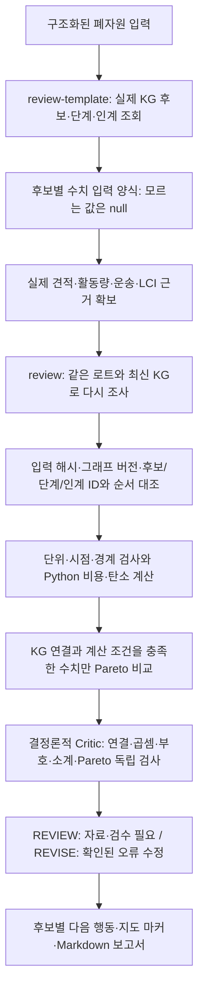

# 실제 KG 후보와 수치를 연결한 경로 검토

이제 **공정 KG에서 나온 실제 후보에 견적·활동량·배출계수를 연결하고, 잘못된 연결과 계산·비교 오류를 확인**할 수 있습니다. 후보별 확인할 일은 보고서와 지도 표시용 데이터로 반환합니다.

가격이나 LCI 값을 자동으로 만들어 주는 기능은 아닙니다. 자료가 없으면 빈 양식과 필요한 자료를 보여 주며, 수치가 완성돼도 최종 추천·시설 인수·운송을 승인하지 않습니다.

## 입력부터 결과까지



수치가 아직 없어도 `/analysis/review`를 호출할 수 있습니다. 전체 후보를 남기고 어느 자료를 채워야 하는지 반환합니다. 진단용 산술 결과와 실제 KG 연결 여부를 구분하며, 연결이 확인되지 않은 수치는 Pareto 비교에 넣지 않습니다.

## 1. KG에서 수치 입력 양식 받기

`POST /analysis/review-template`

아래는 **가상 PP 로트의 요청 예시**입니다. 실제 공장에서 받은 자료라는 뜻이 아닙니다.

```json
{
  "lot": {
    "material": "PP",
    "input_form": "scrap",
    "quantity_kg": 3000,
    "color": "검정"
  },
  "max_pages": 20
}
```

이 호출은 현재 KG의 후보를 수집합니다. **법령 검색이나 생성 모델을 호출하지 않습니다.** 후보 수와 공정 ID를 예제에 고정하지 않고 실제 응답에서 읽습니다.

| 응답 필드 | 쓰는 곳 |
| --- | --- |
| `input_sha256` | 양식을 만든 로트와 수치를 제출하는 로트가 같은지 확인 |
| `graph_trace` | 양식과 검토가 같은 공정 KG 세대를 사용하는지 확인 |
| `candidates[].candidate_id` | 수치를 붙일 실제 공정·시설 경로 ID |
| `candidates[].stage_ids` | 공정 단계의 ID와 순서 |
| `candidates[].handoff_ids` | 단계 사이 인계 구간의 ID와 순서 |
| `candidates[].stages` | 공정·시설 이름과 인수 미확인 표시 |
| `candidates[].required_lines` | 비용·탄소를 계산하려면 필요한 항목 |
| `basis_template` | 로트 물량·지역과 추가로 채워야 할 기준일·연도·탄소 방법 |
| `coverage` | 수집 범위·추가 페이지·누락 입력. 국내 모든 공정·시설을 포괄한다는 뜻은 아님 |

`required_lines`의 `activity`, `activity_unit`, `factor`, `factor_unit`, 두 근거 ID는 처음에 **`null`**입니다. 모르는 처리비·거리·배출계수를 0이나 임의 평균값으로 채우지 않습니다. `basis_template`도 입력하지 않은 값은 그대로 비워 둡니다.

양식의 필수 항목은 다음과 같습니다.

| 항목 | 연결 대상 |
| --- | --- |
| 공정 비용·탄소 | 각 `stage_id` |
| 발생지에서 첫 시설까지 운송 비용·탄소 | `candidate_id` 뒤에 `:origin-transport`가 붙은 대상 |
| 중간 시설 사이 운송 비용·탄소 | 각 `handoff_id` |
| 잔재물 처리 비용·탄소 | 해당 `candidate_id` |
| 매각 수익 | 해당 `candidate_id`의 비용 항목 |

양식은 실제 확인한 KG 경로의 비용 항목을 빠뜨리지 않도록 만드는 목록입니다. 해당 시설의 현재 견적이나 이번 로트의 인수 확약은 아닙니다.

## 2. 사람이 확보해서 채울 자료

가격·배출계수·수율은 KG의 공정 이름만으로 알 수 없습니다. 우선 다음 자료를 확보해야 합니다.

1. **처리·매각 견적:** 해당 소재·오염·물량의 처리비, 전처리비, 매각 단가와 유효 기간을 확인합니다.
2. **활동량:** 원래 투입량과 공정별 실제 처리량·잔재물량·판매량, 사용 전력 등의 근거를 확보합니다. 원래 투입량을 모든 단계의 산출량으로 복사하지 않습니다.
3. **운송:** 발생지→첫 시설과 시설 사이 각 구간의 실제 운송 조건·활동량·단가를 확보합니다. 이 API가 도로거리를 조회하거나 운송비를 추정하지는 않습니다.
4. **탄소:** 해당 공정·운송·지역·연도에 맞는 LCI 또는 배출계수와 단위·평가 방법·적용 범위를 확인합니다.
5. **운영 조건:** 시설의 현행 허가 범위, 투입 규격, 이번 로트 인수, 여유 용량·일정을 별도로 확인합니다. 수치가 있다는 이유로 운영 확인이 끝나지는 않습니다.

수치 하나에는 활동량 근거와 단가·배출계수 근거가 각각 필요합니다. 원문 URL뿐 아니라 페이지·표·항목 같은 `locator`, 유효 기간, 지역, 평가 연도를 함께 기록합니다. URL이 존재하거나 `synthetic=false`로 제출됐다는 사실만으로 원문의 진위·해당 시설 적용성이 검증되지는 않습니다.

**실제 자료는 `mode=submitted_evidence`, 가상 시연은 `mode=simulation`으로 구분**합니다. 가상 근거에는 `synthetic=true`를 붙입니다. 가상 수치로 계산한 결과를 실제 절감액·배출량으로 발표하지 않습니다.

## 3. 확보한 수치로 통합 검토하기

`POST /analysis/review`

수치 확보 전에는 다음처럼 `numeric`을 생략합니다. 이 요청도 앞과 같은 **가상 로트 예시**입니다.

```json
{
  "research": {
    "lot": {
      "material": "PP",
      "input_form": "scrap",
      "quantity_kg": 3000,
      "color": "검정"
    },
    "max_pages": 20,
    "max_legal_queries": 24,
    "legal_top_k": 3
  }
}
```

기본 경로는 기존 로컬 법령 검색을 사용하므로 생성 모델이 필요하지 않습니다. `research.legal_graph`를 명시적으로 선택하면 [법률 그래프 검증](legal-hierargraph.md)의 모델 설정과 보강된 그래프가 필요합니다. 양식 생성과 결정론적 Critic 자체는 모델이 필요하지 않습니다.

수치를 확보했다면 요청의 `numeric` 안에 아래 세 필드를 넣습니다.

| 필드 | 입력 규칙 |
| --- | --- |
| `input_sha256` | 같은 로트로 만든 양식의 값을 그대로 사용 |
| `graph_trace` | 같은 양식의 전체 값을 그대로 사용 |
| `comparison` | 기존 `ScenarioComparisonRequest` 형식의 비교 기준·근거·후보별 수치 |

`comparison`은 기존 [수치 비교 계약](candidate-analysis.md)을 사용합니다.

- `basis`: 같은 물량, 기준일, 지역, 평가 연도, 탄소 평가 방법을 지정합니다. 경계는 투입 폐기물부터 산출물 출하까지 공정·운송·잔재물을 포함하며, 버진 대체에 따른 회피 배출 공제를 포함하지 않습니다.
- `evidence`: 활동량 근거는 `activity_record`, 단가 근거는 `cost_factor`, 배출계수 근거는 `carbon_factor`로 연결합니다.
- `scenarios`: 실제 응답의 `candidate_id`, 순서가 보존된 `stage_ids`·`handoff_ids`, 근거를 확보한 `lines`를 제출합니다. 각 시나리오의 `basis`는 공통 `basis`와 같아야 합니다.
- `lines`: 양식의 `line_id`, `target_id`, `metric`, `category`를 사용하고 확보한 활동량·단가/계수·단위·두 근거 ID를 채웁니다. 예를 들어 활동량 단위가 `kg`이면 비용 계수는 `KRW/kg`, 탄소 계수는 `kgCO2e/kg`입니다.

양식의 `null`은 제출 가능한 숫자가 아닙니다. 자료가 아직 없으면 해당 수치를 만들지 말고 검토 요청에서 `numeric`을 생략하거나, 확보한 항목만 제출해 부족 상태를 확인합니다. **0이라는 값에도 근거가 필요합니다.**

## 4. 무엇을 검증하나요?

| 확인 | 잘못됐을 때 |
| --- | --- |
| 양식과 현재 입력의 `input_sha256` | 로트의 물량·색상·성상 등 조건이 바뀌면 예전 수치를 재사용하지 않음 |
| 양식과 현재 KG의 `graph_trace` | 다른 그래프 버전의 수치를 바로 적용하지 않음 |
| 실제 후보·단계·인계 ID와 순서 | 가짜 후보, 임의로 뺀 단계, 뒤바뀐 인계, 중복 후보를 수치 비교에서 제외 |
| 원래 물량과 비교 물량 | 같은 로트·기능단위가 아니면 비교를 차단. 물량 미확인은 추가 자료 요청 |
| 근거 종류·단위·기간·지역·연도·탄소 방법 | 조건 불일치와 누락을 각각 표시 |
| 계산 항목과 필수 범위 | 처음 운송·중간 운송·잔재물·매각 수익 누락을 표시 |
| 곱셈·수익의 음수 부호·소계·총계 | 계산 결과를 입력에서 독립적으로 재검산 |
| Pareto 후보 범위·중복·누락·지배 관계 | KG에 연결된 비교 가능 수치로 올바른 층을 만들었는지 독립 검사 |

비용은 처리·운송·잔재물 비용에서 매각 수익을 뺍니다. 탄소는 제출한 활동량과 배출계수를 같은 경계에서 계산합니다. 누락된 숫자를 0으로 간주하지 않으며, 알려진 소계와 미완성 총계를 구분합니다.

독립 Critic은 최적화 함수를 다시 호출하는 방식으로 정답을 베끼지 않고, 후보 사이 비용·탄소의 지배 관계를 대조합니다. 다만 **코드로 재현할 수 있는 구조·산술 검산**이며 법규 해석·원문 진위·공정 기술의 타당성을 판단하는 의미적 LLM Critic은 아닙니다.

잘못 연결된 수치는 그 후보의 수치 비교에서 빠지지만, 원래 공정 후보 자체를 숨기지는 않습니다. 수치가 없는 후보·제외한 제출값·미확인 운영 조건도 함께 반환합니다. 수치상 Pareto는 법규·시설 적합성이 검증된 최종 순위가 아닙니다.

## 5. 결과에서 볼 것

| 응답 필드 | 의미 |
| --- | --- |
| `research` | 공정 KG 후보·시설 공개 조건·법령 조사 결과 |
| `binding` | 현재 입력 해시·그래프 버전과 제출 수치의 연결 상태 |
| `numeric_review.results` | 후보별 산술 결과, KG 연결 여부, 수치 비교 포함 여부 |
| `numeric_review.pareto_fronts` | 실제 KG와 연결되고 수치 조건을 충족한 후보만의 Pareto 층 |
| `numeric_review.excluded_submission_ids` | 비교에 넣지 않은 제출 후보 |
| `numeric_review.unsubmitted_candidate_ids` | 현재 KG 후보 중 수치를 제출하지 않은 후보 |
| `critic` | 문제 코드·원인 단계·대상 ID·근거 ID·메시지·다음 행동 |
| `router` | REVIEW/REVISE와 수정 시작 단계·후속 무효화 범위 |
| `candidate_reviews` | 후보별 확인할 일과 수치 비교 포함 여부 |
| `map_markers` | 공정 지도에 연결할 표시 데이터. 실제 3D 화면 연동은 별도 작업 |
| `stage_statuses` | 이번 요청이 각 단계를 어디까지 수행했는지 |
| `report_markdown` | 후보별 확인 사항과 다음 행동을 담은 검토 보고서 |

`critic.severity=missing`은 자료나 검수가 부족하다는 뜻입니다. `error`는 연결·계산 등에 확인된 모순이 있다는 뜻입니다.

- **REVIEW:** 자료·운영 확인·법규 검수가 남음. 자료 없음 자체를 불가능·적합으로 판정하지 않습니다.
- **REVISE:** 입력·KG 연결·단위·계산·비교 등의 오류를 수정해야 함. `restart_from`과 `invalidate_on_revision`으로 다시 검토할 범위를 제시합니다.

`automatic_reexecution=false`이므로 오류를 수정한 뒤 사용자가 다시 요청해야 합니다. 모든 결과에서 최종 추천 목록은 비어 있고 `dispatch_approved=false`입니다.

지도 표시는 `candidate_id`와 `target_id`로 후보·공정·인계 구간에 연결합니다. `on_map=true`인 항목만 현재 지도 대상에 대응합니다. `confirmed_operational_incident=false`이므로 느낌표는 실제 발생한 사고를 뜻하지 않습니다. 확인할 자료·조건과 수정할 입력·계산 오류를 구분해 보여 줘야 합니다.

## 현재 한계와 다음 행동

이 기능은 기존 `/analysis/research`, `/analysis/compare-scenarios`를 유지하면서 추가한 내부 API입니다. Re_server를 통해 호출하고 반환한 ID를 그대로 사용합니다.

아직 **PASS·최종 Top K 추천, 의미적 LLM Critic, 자동 부분 재실행, 영구 실행 이력, 운영 승인, 3D 화면 자동 연동**은 구현하지 않았습니다. 원문 URL·수치가 제출돼도 원문의 진위와 실제 시설에 대한 적용성은 별도 검수가 필요합니다.

다음 실무 작업은 한 로트를 정해 양식에 나온 각 경로의 **처리·매각 견적, 실제 운송 조건, 공정별 활동량·잔재물·수율, 적용 가능한 LCI/배출계수, 현행 허가·인수 조건**을 확보하는 일입니다. 확보하지 못한 항목을 빈 상태로 두고 먼저 검토하면 어떤 자료부터 채워야 하는지 확인할 수 있습니다.

실제 KG의 출처 기반 경로, 사용자가 입력한 로트, 제출한 수치의 출처는 서로 다른 검증 범위입니다. 가상 로트·가상 견적의 회귀 검사 통과를 실제 시설 인수나 추천 정확도로 표현하지 않습니다.

## 검증 기록과 다음 작업 순서

2026-10-22 전체 회귀는 실제 Neo4j를 포함해 **554개와 subtest 24개 통과, PostgreSQL 통합 1개 건너뜀**입니다.
보고서의 수치 표시는 별도 단위 검사로 확인했습니다. 실제 활성 KG에 가상 PP 3톤·가상 숫자를 넣은
[API 연결 검사](evaluation/grounded-review-2026-10-22.json)는 **17/19 통과**입니다.
최초 실행은 Docker 시작 오류로 PostgreSQL에 연결되지 않아 실제 검색과 기존 7문항 검색 회귀를 확인 실패로 기록했습니다.
이전 적재 성공 기록이나 검색 성공을 현재 실행의 성공으로 대신 쓰지 않습니다. 생성 모델 실호출은 0회입니다.

이후 Docker 임시 통신 폴더를 백업 이름으로 보존하고 재생성해 복구했습니다. PostgreSQL은 healthy이며 기존 6문서·216청크를 재확인했습니다.
건너뛴 실제 Neo4j→PostgreSQL 통합 검사도 별도로 1개 통과했고 GitHub CI 두 작업도 통과했습니다.
[복구 후 API 검사](evaluation/grounded-review-recovered-2026-10-22.json)는 **18/19 통과**입니다.
실제 검색은 정상이나, 자료 보강 후 기존 검색 평가가 **6/7**입니다. 허가 범위·처리 능력 질문의 기대 제25조가 상위 5개에 들지 않은 1건을 검색 품질 보강 과제로 남깁니다.
DB 장애와 검색 품질 실패를 구분하며, 평가 기대값을 바꿔 통과시키지 않습니다.

```bash
python scripts/evaluate_decision_review.py --output docs/evaluation/grounded-review-local.json
```

실제 Neo4j·공식 문서가 적재된 로컬 PostgreSQL과 기존 E5 임베딩 설정이 필요합니다. 이 명령은 DB를 변경하지 않습니다.
가상 숫자임을 명시한 보고서 파일도 필요하면 `--report` 경로를 지정합니다. 실패한 확인 항목이 있으면 종료 코드 1입니다.

| 순서 | 할 일 | 완료 기준 |
| --- | --- | --- |
| 1 | 검색 품질 회귀 1건 원인 분석·보강 | DB 복구·재실행 완료. 허가 범위 질문의 후보 회수·중복·재정렬을 점검하고 기존 기대값 유지·추가 질문으로 검증 |
| 2 | PP 한 로트와 후보 경로의 실제 근거 채우기 | 공정·품목·사업장별 허가·투입 규격·수탁 가능 여부·견적·운송 조건 확보 |
| 3 | LCI와 공정별 활동량 연결 | 공정·국가·연도·단위·경계·수율/잔재물 적용 검수. 다른 공정의 계수를 임의로 재사용하지 않음 |
| 4 | 요청대로 모델은 나중에 연결 | 원문 특징·요건 생성과 실제 Researcher/Auditor 호출을 별도 평가. 가상 응답과 분리 |
| 5 | 검증 기준과 전문가 정답셋 | 실제 사례에서 적용성·누락 경로·수치·반박의 정답 검수. PASS·최종 Top K 기준 결정 |
| 6 | 실행 이력·부분 재실행·서버/지도 연결 | 데이터 변경 시 뒤 결과 무효화·재계산·추적, 실제 화면에서 대상 ID로 확인 과제 표시 |

노션 진행보드 정리는 접근 복구 후 최신 카드를 다시 읽고 반영해야 합니다.
완료한 온톨로지·RAG 두 카드의 본문·상태·담당자·속성은 보존합니다.
