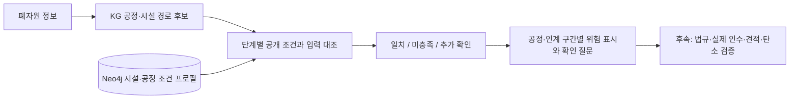

# 공정·시설 조건을 입력과 대조하기

지금까지는 공정 순서와 조사할 시설을 찾았습니다. 이제는 그 연결의 공개 근거와
사용자가 넣은 폐자원 조건을 대조하고, **미충족 조건과 아직 모르는 조건**을 돌려줍니다.



## 어떤 조건을 넣었나요?

초기 14개 `FacilityCapability` 연결에 `input_profile`을 추가했고, 제지 공정 세분화 후 현재 18개입니다.
새 업체를 이름만 보고 경로에 넣은 것이 아니라, 기존의 출처 있는 연결을 구조화했습니다.

| 필드 | 의미 |
| --- | --- |
| `evidence_scope` | 사업장 공정 공개 자료인지, 기업 전체 소개에서 가져온 사업장 가설인지 |
| `material_examples`, `form_examples` | 공개 자료에 나온 소재·형태 예시. 전 품목을 나열한 독점적 인수 목록이 아님 |
| `output_description` | 해당 경로에서 조사하는 산출물 설명. 실제 납품 규격·품질 보증이 아님 |
| `source_ids`, `locator` | 어느 원문의 어느 부분에서 확인했는지 |
| `excludes_designated_waste` | 명시적으로 확인한 지정폐기물 취급 제외 정책. 자료가 없으면 `null` |
| `exclusion_source_ids`, `exclusion_locator` | 제외 정책 자체의 출처 |
| `verified_intake_limits_available` | 검수된 수분·오염·물량 등의 수치 한도를 확보했는지. 현재는 `false` |

공개 페이지의 사실과 상담 범위는 다음처럼 제한해서 사용합니다.

- [중앙이엔비 FAQ와 공정](https://www.jungangenb.com/): PE·PP와 잔재물 관련 상담 안내,
  파쇄품 공급, Q06의 지정폐기물 취급 제외 정책을 기록했습니다.
  [공정 페이지](https://www.jungangenb.com/process)의 환경 관리에서도 제외 정책을 확인했습니다.
  회사가 게시한 정책이며 관할기관의 현행 허가 검증은 아닙니다.
- [삼양 PET 재활용](https://www.samyangpackaging.com/kr/business/pet-recycling):
  폐PET병에서 플레이크로 이어지는 생산공정과 시화 사례입니다. 압축 단계가 있다는 사실로
  외부 베일 전 품목을 받는다고 확대하지 않습니다.
- [BGF 재활용 소재](https://www.bgfecomaterials.com/kr/company/business/recycle):
  기업 전체의 소재·공정 소개를 사업장별 가동·수탁 증거로 바꾸지 않습니다.
  기존 예산·화성 연결은 계속 `site_role_hypothesis`입니다.
- [Novelis 영주 사례](https://investors.novelis.com/news-events/press-releases/detail/1316/novelis-yeongju-plant-achieves-120-billion-aluminum-cans-recycled-milestone-in-its-first-decade):
  2021년 사용 후 음료캔과 판재 생산 사례입니다. 절삭칩 등 다른 투입물을 자동 승인하지 않으며
  당시 공시 용량을 지금의 여유 용량으로 사용하지 않습니다.
- [한솔페이퍼텍](https://www.hansolpapertech.com/home/): 고지와 펄프를 배합한 표면지 설명입니다.
  특정 등급·코팅·오염 폐지를 인수한다는 기준으로 확대하지 않습니다.
- [한솔페이퍼텍 생산공정](https://www.hansolpapertech.com/intro/present.jsp): 공개된 10개 작업을
  5개 단계로 연결했습니다. 첫 로트는 해리 단계에 대조하고 후속 단계는 실측 미확인으로 표시합니다.
- PE 소재군 일치와 HDPE·LDPE·LLDPE 등의 세부 수지 인수 적합성을 구분합니다.
  후속 단계의 세부 수지도 확인이 필요하며 첫 로트의 등급을 측정값처럼 복사하지 않습니다.

초기 공식 원문 6개에 이어 제지 공정·PP 기술 지침 2개를 추가 확보했습니다. 원본 페이지·이미지는 Git에
넣지 않았고, 사실 요약과 출처를 포함합니다. 차단된 원문은 우회 수집하지 않았습니다.
[최신 보강 범위](kg-evidence-upgrade.md)에서 출처·등급·연결 검사의 제한을 확인합니다.

## 대조 결과를 어떻게 읽나요?

| 상태 | 뜻 | 예시 |
| --- | --- | --- |
| `matched` | 해당 항목의 입력과 공개·모델 조건이 일치 | PP 공정에 PP를 넣음, 공개된 폐PET병 예시에 병 형태가 일치 |
| `unmet` | 선택한 공정과 소재가 다르거나 명시적 제외 정책과 충돌 | PP 전이에 PET 입력, 취급 제외 정책이 있는 시설에 지정폐기물이라고 입력 |
| `needs_verification` | 기준이나 사실을 확보하지 못했거나 사업장 연결이 가설 | 수분 기준 없음, 실제 인수·허가 미확인, 후속 단계 실측 미확인 |

사용자가 지정폐기물이라고 입력한 값도 사용자 제공 사실이며 법적 분류 검증은 별도입니다.
소재 예시 목록에 없는 품목은 곧바로 거절하지 않습니다. 선택한 PP 공정과 PET가 다르다는
판정도 그 시설이 다른 PET 공정을 수행할 수 없다는 뜻은 아닙니다.

각 항목의 일치가 실제 인수 승인을 뜻하지는 않습니다. 현재 모든 결과의
`all_operational_conditions_verified`와 `dispatch_approved`는 `false`입니다.
전체 경로는 하나라도 미충족이 있으면 `unmet`, 그 외에는 현재 `needs_verification`으로 남습니다.
미충족 경로도 숨기지 않아 사용자와 후속 검증기가 이유를 볼 수 있습니다.

## API 1: 한 시설·공정 연결을 대조하기

`POST /kg/facility-assessment`

```json
{
  "capability_key": "jungang-gongju--pp-prepare",
  "lot": {
    "material": "PP",
    "input_form": "scrap",
    "quantity_kg": 3000,
    "color": "검정",
    "moisture_pct": 25,
    "designated_waste": false
  }
}
```

이 가상 입력은 소재와 공개 예시의 일치, 회사의 공개 제외 정책과의 대조를 보여줍니다.
수분 25%나 3톤을 적었다고 임의의 수치 기준을 만들어 통과·탈락시키지 않습니다.
확보한 한도가 없어 수분·물량·색상·순도·현행 허가·인수는 추가 확인으로 나옵니다.

시설 명부의 `listing_id`를 바로 평가할 수는 없습니다. 동일 사업장 식별과 공정 수행 근거를
확보해 `FacilityCapability`로 연결한 뒤 프로필을 작성해야 합니다.

## API 2: 경로 생성부터 단계별 대조까지

`POST /kg/assessed-plans`

```json
{
  "material": "PP",
  "input_form": "scrap",
  "quantity_kg": 3000,
  "color": "검정",
  "moisture_pct": 25,
  "contamination_pct": 12,
  "designated_waste": false,
  "page_size": 25
}
```

응답의 `planning`에는 기존 경로·시설·출처가 있고, `assessments`에는 같은 `plan_id`의
단계별 항목과 위험이 있습니다. 현재 PP는 파쇄품·펠렛·컴파운드 종료점의 세 경로를 유지합니다.
최종 추천 순위나 비용·탄소 비교 결과가 아닙니다.

첫 단계는 사용자가 준 값을 대조합니다. 두 번째 단계부터는 **예상 상태와 실제 로트를 구분**해
`projected_state_not_measured`로 표시하고 로트 값은 `null`로 둡니다. 예를 들어 처음의 수분 25%를
세척 후 수분이라고 복사하거나, 세척이 있다는 이유로 오염 0%로 만들지 않습니다.

`risks[].target_id`는 해당 응답에 있는 `stage_id` 또는 인계 `leg_id`입니다.
인계 규격 확인은 해당 인계 구간에 연결되므로 화면에서 공장 사이의 길에 표시할 수 있습니다.
`actual_incident_confirmed=false`이며 실제 사고가 발생했다는 기록은 아닙니다.

다음 페이지는 **같은 `/kg/assessed-plans`**에 `planning.pagination.next_cursor`를
`cursor`로 보내면 됩니다. 소재·물량뿐 아니라 수분·오염·지정 여부도 같은 값으로 유지해야 합니다.
커서를 `/kg/process-plans`에 보내면 안 됩니다. 형식·요청 불일치는 `400`, 세대 변경은 `409`입니다.
미적재·변조·DB 장애는 `503`, 잘못된 입력·외부 모델 보기 요청은 `422`입니다.

이 두 API는 서버 내부용입니다. 사용자 로트와 평가 결과를 Neo4j에 저장하거나 외부 모델에
전송하지 않습니다. 현재 법령 RAG를 자동 호출하거나 허가를 판정하는 실행기는 아닙니다.

## 적재·검증

Neo4j 온톨로지는 v1.2를 유지하며, 시설 조건을 포함한 참조 자료는 `planning-reference-v2`로
올렸습니다. 기존 세대의 공정·시설 자료는 새 내용과 다르므로 다시 적재합니다.

```bash
resource-kg import --rebuild
resource-kg audit
python scripts/evaluate_facility_assessment.py --output condition-evaluation.json --scenario-output pp-condition-scenario.json
```

타입·출처 연결을 검사하고 조건 프로필을 `FacilityCapability` 노드의 레코드에 함께 저장합니다.
API는 그 Neo4j 레코드와 실제 관계를 대조한 뒤 읽습니다. 로컬 JSON을 장애 시 대체 결과로
반환하지 않습니다. 기존 세대는 보존하며 새 적재가 실패하면 활성 세대를 교체하지 않습니다.

검증 사례 16개는 **가상 입력 + 문서로 판단 가능한 기대 결과**입니다. 실제 고객 자료나
산업 전문가가 확정한 현장 정답이 아닙니다. 지정 여부·소재 불일치·사업장 가설·형태 예시·
미공개 수치 한도·설계 용량 오해를 검사합니다. 전체 테스트 362개와 24개 하위 검사,
실제 API의 조건·흐름 검사 **120/120**이 통과했습니다.

- [검증 사례](../data/config/facility_assessment_eval.json)
- [실제 API 검증 결과](evaluation/facility-conditions-2026-10-21.json)
- [검정 PP 3톤 가상 시나리오 결과](evaluation/pp-condition-scenario-2026-10-21.json)

## 다음에 채워야 할 것

| 필요한 데이터 | 필요한 기술 |
| --- | --- |
| 시설별 서면 투입 규격·수분·오염·색상·등급 한도 | 한도·단위·적용 상태·예외를 타입화한 수치 판정 |
| 최신 허가 문서와 폐기물 분류 근거 | 법령 RAG·허가 자료와 규칙 대조, 원문·예외 검증 |
| 실제 로트 성분·측정값, 단계별 물질수지·인계 규격 | 실측값과 예상 상태 추적, 공정 사이 조건 검증 |
| 현재 인수·일정별 여유 용량·견적 | 운영 사실의 만료·재확인과 시설 응답 연계 |
| 검수자가 확인한 실제 사례와 제외 사유 | 추천 누락·잘못된 통과·보류 처리를 측정하는 평가셋 |

이번 작업으로 **공정 후보 → 단계별 시설 조건 대조 → 공정·구간별 확인 과제**가 연결됐습니다.
실행 가능성 확정, 비용·탄소·최종 Critic·추천은 후속 단계입니다.
