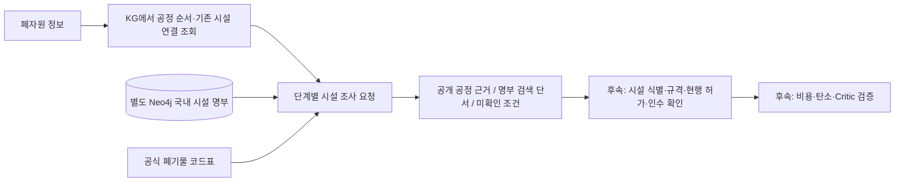

# 공정에 맞는 시설을 어떻게 찾나요?

KG가 **가능한 공정 순서**를 만들고, 이 API가 **각 공정의 시설 조사**를 돕습니다.
전국 기업의 실제 거래망을 새로 만드는 기능은 아닙니다.

예를 들어 PP 경로에 `선별·파쇄 → 세척 → 압출`이 있으면, 각 단계마다 다음을 구분합니다.

1. 공개 자료에 해당 시설의 공정이 나와 있는가?
2. 명부에서 추가로 조사할 만한 시설을 찾을 수 있는가?
3. 이번 PP를 실제로 받을 수 있는가? **이 부분은 아직 확인해야 합니다.**



W2RKG 문헌 조회와 이 기능은 구분합니다. 공정 순서는 별도로 출처를 확인해 작성한
`planning-reference.json`에서 가져오며, 전국 명부는 새로운 시설을 조사할 때 사용합니다.
명부에 이름이 있다는 이유로 그 시설을 공정 경로에 자동으로 넣지 않습니다.

## 지금 사용할 수 있는 API

`POST /kg/facility-candidates`

2026-10-24부터 `sort_by`를 선택할 수 있습니다. 기본 `relevance`는 기존 검색 순서를 유지하며,
`straight_line_distance`는 출발 위도·경도가 모두 필요하고 전체 매칭 목록을 거리순으로 정렬한 뒤 페이지를 자릅니다.
좌표 없는 레코드는 뒤에 보존합니다. 정렬·좌표를 바꾸면 커서를 재사용할 수 없습니다.
조회 알고리즘은 v3이며 예전 v2 커서는 첫 페이지부터 다시 조회해야 합니다.
여러 공정을 한 번에 조사하려면 [사업장별 시설 조사 API](site-discovery-api.md)를 사용합니다.

```json
{
  "transition_key": "pp-clean",
  "region": "경기도",
  "origin_latitude": 37.2,
  "origin_longitude": 127.0,
  "page_size": 25
}
```

이 예시는 가상 발생지에서 PP 세척 단계의 시설을 조사하는 요청입니다.
`transition_key`는 `/kg/process-plans` 결과의
`stages[].facility_search_request.transition_key`를 그대로 사용합니다.
`region`과 좌표는 선택 항목이며, 좌표는 위도·경도를 함께 입력합니다.

| 응답 | 팀원이 읽는 방법 |
| --- | --- |
| `reference_bindings` | 기존 KG의 출처 있는 시설 연결. 특정 사업장 공정의 공개 근거인지, 역할을 바탕으로 한 가설인지 구분 |
| `registry_candidates` | 국내 명부에서 찾은 추가 조사 대상. 처리 가능한 시설로 확정한 결과가 아님 |
| `material_match` | 소재 이름·넓은 분류·코드·미해석 코드 중 어떤 단서로 찾았는지 표시 |
| `code_interpretations` | 코드의 명칭 일부, PDF 쪽수, 지정/일반/생활 분류 구획과 미해석 상태 |
| `equipment_mentions` | 해당 단계와 관련된 설비 단어가 명부에 있는지 표시. 전체 공정 수행 능력을 입증하지 않음 |
| `evidence_links` | 검수한 명부 행·사업장 식별과 이번 요청 공정의 공개 근거. 이름만 자동 매칭하지 않음 |
| `straight_line_distance_km` | 좌표가 있을 때만 직선거리. 도로 운송거리·운송비가 아님 |
| `current_permit_scope`, `current_acceptance`, `current_available_capacity_kg` | 확보하지 못했으므로 `null` |
| `search_scope.match_counts` | 검색 단서별 건수. 미해석 코드의 확인 대상도 별도로 집계 |
| `graph_trace` | 공정 KG·명부·코드표의 조회 버전과 해시 |

검색 순서는 **관련 설비 단어 → 소재 단서의 종류 → 직선거리 → ID**입니다.
검수된 사업장 연결·공정 근거는 [별도 상태](facility-identity-evidence.md)로 표시하며 거리 정렬이나 실제 허가·인수 승인과 구분합니다.
설비 단어가 없거나 주소가 비어 있는 후보도 보존합니다.
운반업·처분업 등록을 재활용 공정 시설로 바꾸지 않습니다. 해당 역할의 별도 탐색은 후속 범위입니다.
지역 필터는 주소의 문자열 포함 여부이며, 행정구역 정규화나 도로 경로 검색은 아직 없습니다.
지역·거리 조건은 추가 명부 검색에만 적용하며, 기존 KG 연결은 별도 목록으로 유지합니다.

`waste_code: "51-03-01"`처럼 코드 하나를 직접 검색할 수도 있습니다.
이때는 명부에 같은 코드가 있는지만 찾습니다. 사용자의 폐기물 분류가 그 코드로 적법하게
확정되었다거나 해당 시설이 특정 등급의 PP를 받을 수 있다고 판정하지 않습니다.

다음 페이지는 같은 요청에 `pagination.next_cursor`를 `cursor`로 보내면 됩니다.
마지막 페이지가 올 때까지 조회하며, `page_size`는 최종 추천 K개를 뜻하지 않습니다.
잘못된 요청·커서는 `400`, 입력 형식 오류는 `422`, 조회 중 데이터 버전 변경은 `409`입니다.
`409`가 오면 앞의 페이지를 버리고 처음부터 다시 조회합니다.

## 어떤 데이터를 넣었나요?

- [전국폐기물처리업소표준데이터](https://www.data.go.kr/data/15114147/standard.do):
  9,604개 **등록 레코드**를 로컬에 확보하고 별도 Neo4j 세대에 적재했습니다.
  이 중 재활용업 문구가 있는 레코드는 3,484개입니다. 중복 사업장·업종이 있을 수 있어
  고유 기업 수가 아니며, 전국 모든 시설을 망라한다고 보장하지 않습니다.
- 원본에는 업체명, 업종, 처리 폐기물, 주소·좌표, 설비명, 허가일, 관리기관, 기준일 등이 있습니다.
  기준일은 레코드마다 다르며 이번 확보 자료는 2023-07-14~2026-09-18입니다.
  허가일 한 칸으로 현행 허가 범위나 현재 인수 여부를 확인할 수 없습니다.
- [폐기물관리법 시행규칙 별표 4](https://www.law.go.kr/법령별표서식/(폐기물관리법%20시행규칙,20261002,별표4)):
  2026-10-02 시행본에 연결된 공식 PDF의 313개 세부분류 코드·명칭 일부·쪽수를 고정했습니다.
  별표 자체의 개정 표시는 2025-12-30입니다. 원문 SHA-256과 수집일도 기록합니다.

**코드표는 검색 범위를 좁히는 용도입니다.** 예를 들어 일반 폐합성수지 분류는
PET·PP·PE의 등급 적합성을 알려주지 않습니다. 고철 코드만 있는 시설을 알루미늄의
단서로 사용하지 않으며, 해석하지 못한 코드가 있으면 확인 대상으로 남깁니다.
과거 명부의 코드가 현재 코드와 같은 의미인지는 아직 검증하지 않았습니다.
검색에서 단서가 없다는 이유로 시설이 부적합하거나 폐업했다고 판정하지 않습니다.

원본 명부는 공개 재배포 조건을 추가 검토해야 하므로 Git과 외부 모델 전송에서 제외합니다.
Git에는 코드표·출처·해시와 검사 보고서만 포함합니다. 에이전트용
`get_facility_candidate_page()`는 외부 모델 보기를 사용해 명부 본문을 가립니다.
지역·발생지 좌표가 필요한 검색은 서버 내부에서 수행합니다.

## 팀원이 다시 수집·적재하는 방법

기존 Neo4j 환경변수를 설정하고 의존성을 설치한 상태에서 실행합니다.

```bash
python scripts/collect_facility_registry.py --output data/local/facilities/national.json
```

생성된 `national.manifest.json`의 `sha256` 값을 아래에 넣습니다.

```bash
resource-facilities data/local/facilities/national.json --format national-json --expected-sha256 <매니페스트의_SHA256>
uvicorn resource_ai.main:app --reload
```

공개 포털의 응답 열·행 수가 바뀌거나 중복 페이지가 감지되면 수집을 중단합니다.
기존 파일은 덮어쓰지 않습니다. 포털 다운로드 구조가 바뀌면 공식 다운로드/API를
확인해 수집기를 수정해야 합니다. 김해시의 별도 CSV 형식도 `--format gimhae-csv`로 지원하며,
현재 활성 명부 한 세대만 검색합니다. 서로 다른 명부를 자동 병합하거나 기업명을 합치지 않습니다.
김해 CSV의 등록일을 데이터 기준일로 바꾸지 않으며, 행에 기준일이 없어 `as_of=null`로 둡니다.

명부는 공정 KG와 분리된 `ReSourceFacilityListing` 노드에 저장합니다.
원본·정규화 레코드·행 수·소유 범위를 검사한 뒤 새 세대로 전환하며, 실패하면 기존 활성
명부를 유지합니다. 실행 중 로컬 JSON이나 SQLite로 대체 조회하지 않습니다.
명부를 적재하지 않은 환경은 `reference_only`로 명시하고 기존 공개 연결만 반환합니다.

코드표를 재현할 때는 공식 PDF를 별도로 내려받은 뒤 실행합니다.
이 스크립트에만 선택 의존성 `pdfplumber`가 필요하며, 원본 해시가 다르면 업데이트를 중단합니다.

```bash
python scripts/extract_facility_codes.py --input annex4.pdf --output reviewed-codes.json
```

## 검증 결과와 남은 부분

2026-10-21 기준:

- 실제 Neo4j를 사용하는 전체 테스트 **327개 통과**, 24개 하위 검사 통과.
- 확보한 전국 명부로 6개 공정 요청을 실행해 API·출처·미확인 값·전송 범위 검사 **207/207 통과**.
- 가상 시설 테스트에서 운반업 혼입, 코드 오해, 누락·변조, 페이지 누락·중복,
  버전 변경, 적재 실패 시 기존 세대 보존을 검사했습니다.
- 상세 결과: [명부 적재](evaluation/facility-registry-import-2026-10-21.json),
  [시설 검색](evaluation/facility-search-2026-10-21.json).

이 수치는 프로그램의 조회·무결성 검사 결과입니다. 실제 공장의 인수 가능성이나 추천
정확도를 측정한 수치가 아닙니다. PP·PE·PET에 같은 넓은 합성수지 후보가 나올 수 있습니다.

| 부족한 데이터 | 필요한 기술 |
| --- | --- |
| 동일 법인·사업장 식별자, 소재별 설비·입출력 규격 | 검수된 시설 식별·공정 연결과 시설별 테스트 사례 |
| 현행 허가 범위·유효성, 이번 물량 인수·여유 용량 | 법규·시설 검증기와 확인 상태 관리 |
| 처리 견적·매각 단가·수율, 실제 운송 경로 | 견적·도로거리 연동과 단위가 맞는 비용 계산 |
| 공정별 LCI·운송 계수·비교 경계 | 같은 물량·경계의 탄소 계산과 근거 검증 |
| 검수자가 확인한 정답 경로·탈락 사유 | 평가셋, Critic과 부분 재실행 연결 |

지금 팀원이 붙일 위치는 **공정 후보 생성 직후의 시설 조사 도구**입니다.
여기서 나온 명부 후보를 곧바로 추천 경로·최적 공장·실행 가능한 계약으로 표시하면 안 됩니다.
