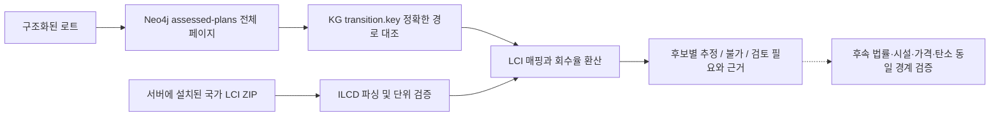

# KG 공정 경로 → 국가 LCI 탄소 예비 산정 API

## 목표

`POST /analysis/kg-lci`는 실제 Neo4j의 **검수된 소재 상태 전이·시설 역할 후보**
(`/kg/assessed-plans`와 같은 데이터 경계)를 전체 페이지에서 수집하고,
사용자가 보유한 로컬 국가 LCI DB를 참조해 **후보별 예비 배출량**을 제공합니다.

기존 `/analysis/research` (법령 근거 검색), `/analysis/compare-scenarios`
(사용자 제출 비용·탄소 산술), 법률 Auditor 및 Critic은 변경하지 않습니다.



## 호출

기존 `AssessedPlansRequest`를 `lot`에 감싸 호출합니다.
`lot.cursor`는 반드시 생략하거나 `null`, `audience`는 `internal`입니다.

```bash
# 서버 운영자가 별도 이용허락 하에 받은 ILCD ZIP만 로컬 폴더에 보관.
export RESOURCE_LCI_DIR=data/local/lci

curl -X POST http://127.0.0.1:8000/analysis/kg-lci \
  -H 'Content-Type: application/json' \
  -d '{"lot":{"material":"PET","input_form":"bottle","quantity_kg":1000,"page_size":1},"max_pages":20}'
```

외부 요청은 서버의 임의 ZIP 경로를 선택할 수 없습니다.
`get_lci_datasets()`는 워커별 한 번만 로드하므로 **원본 교체 후 서버 재시작**이
필요합니다. ZIP 원본·원시 흐름·고객 자료는 Git에 포함하지 않습니다.

## 수행과 안전한 누락 처리

1. `GraphQuery.assessed_plans()`의 전용 내부 응답을 모든 페이지에서 조회.
   그래프 세대·공정 건수·소재·페이지 중복·시설 조건 목록과 ID를 교차 확인.
   변경 시 `409 kg-lci-integrity` 또는 기존 KG 오류 코드 반환.
2. `research_packet.stages[].transition.key`를 **순서대로** 읽고 임의 공정
   연결이나 소재명 추측을 하지 않습니다.
3. 사용자가 `input_form=bottle`을 명시한 **PET**이고 경로가 정확히
   `pet-prepare → pet-wash → pet-finish`라면, 전체 3단계를 포함한
   **재활용 플레이크 통합 LCI**를 단 한 번 매핑합니다.
4. 추가 `pet-pelletise` 경로, LCI에 없는 다른 재활용 소재/경로,
   원본이 없는 경우 `UNMATCHED` / `UNAVAILABLE` / `REVIEW_REQUIRED`입니다.
   **중간 단계마다 플레이크 LCI를 재사용하지 않습니다.**
5. 폐PET 1t 입력 시 기존 원본의 투입·산출 관계에 따라 예비값을 산정하되,
   공정이 실제 시설에서 가능한지는 판단하지 않습니다.
6. 결과에서 `plan_id`, `stage_ids`, `handoff_ids`, 시설 공개 조건 확인 상태,
   `graph_trace`, LCI 파일/해시/연도/참조 흐름과 단위, 제외 조건을 반환합니다.

`quantity_kg`가 없으면 배출량은 `null`; 없는 파일을 0으로 채우지 않습니다.
한 번에 일부 페이지만 읽으면 `coverage.complete_within_curated_scope=false`,
`coverage.next_cursor`와 전체 열거 후보 수를 표시합니다. 사용자가 전체 후보를
읽었다고 오해하지 않도록 합니다. 재활용·소각의 시스템 경계 및 산출물 차이가
해결되지 않았으므로 비교·최종 Top K는 **항상 비활성**입니다.

PET 소각은 기존 LCI 모듈에서 지원하더라도, 현재 검수된 KG의 PET 공정 경로에는
소각 전이가 없습니다. 따라서 이 엔드포인트에서 **가상의 소각 후보를 생성하지 않습니다**.

다른 소재의 소각 LCI 확장 PR #29도 별도로 진행 중이며, 병합되더라도
**실제 KG에 연결된 적합한 소각 전이**가 없는 소재에 소각 숫자를 강제로 붙이지
않습니다.

## 범위와 남은 통합

- 현재 기능: 구조화 입력 → 실제 KG 경로·공개 시설 조건 → 로컬 LCI 근거 →
  경로별 탄소 예비치/누락사유/출처.
- **아직 없음:** 법률 Auditor의 적용성 판정, 시설의 현재 수용·허가·견적,
  도로거리·전 구간 운송/잔재물 탄소, 사용자 업로드한 기업 실적 비교,
  총 탄소배출량 확정, Pareto/비용과 동일 경계 비교, Critic·Router·최종 추천.
- **주의:** 국가 LCI DB의 상업적 사용은 제공기관의 이용 조건을 확인해야 합니다.

검증:
```bash
pytest -q tests/unit/test_kg_lci_screening.py tests/unit/test_lci_carbon.py
# 실제 Neo4j 조건 검사 (기존 CI와 동일)
RUN_NEO4J_INTEGRATION=true pytest -q tests/integration/test_analysis_neo4j.py
```

단위 테스트는 출처 데이터셋의 **형식만 모사한 합성 메타데이터**를 사용합니다.
원본 LCI 파일의 세부 값 검증 및 실제 법률·시설 인수 정확도와는 구분해야 합니다.
