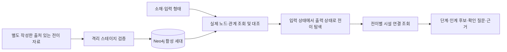

# KG 공정·시설 경로 조사 API

`POST /kg/process-plans`는 공개 출처를 확인해 작성한 **소재 상태 전이**와
**시설별 공정 연결**을 조합해 조사 경로를 반환합니다. 반환된 경로의 상태는
`graph_compatible`입니다. 실제 로트의 처리 가능성, 업체 인수, 운송, 법규 적합성이나
추천 순위를 판정한 결과가 아닙니다.

## 어떤 자료를 연결하는가

W2RKG 원본 행은 문헌 조사 후보입니다. 원본의 폐기물·공정·산출물·참고문헌 표현을
보존하며, 쉼표로 나열한 공정을 실행 순서로 바꾸지 않습니다.
`/kg/candidate-pool`은 그 문헌과 기존 조사 카드·조건부 경로를 조회하는 별도 API입니다.

이번 경로 탐색에는 팀이 따로 작성한
[`planning-reference.json`](../src/resource_ai/knowledge_graph/resources/planning-reference.json)의
`planning-reference-v2` 자료를 사용합니다. W2RKG에서 자동 추론한 공정망이 아닙니다.
현재 범위는 PET·PP·PE·알루미늄·종이의 국내 공개 사례입니다.
v2에는 시설별 공개 조건 프로필이 추가됐습니다. [조건 대조 API](kg-facility-conditions.md)는
이 자료를 실제 입력과 대조하며 현행 허가·인수를 승인하는 기능과 구분합니다.

| 자료 | 현재 수 | 의미 |
| --- | ---: | --- |
| `Organisation` | 5 | 삼양에코테크, BGF에코사이클, 중앙이엔비, 노벨리스코리아, 한솔페이퍼텍 |
| `Facility` | 7 | 시화, BGF 인천·예산·화성, 공주, 영주, 담양 사업장 |
| `MaterialState` | 19 | 병, 파쇄품, 세정 투입물, 펠렛 등 조사용 상태 |
| `ProcessTransition` | 14 | 입력 상태에서 출력 상태로 이어지는 명시적 전이 |
| `FacilityCapability` | 14 | 전이를 특정 시설에 연결한 출처와 확인 조건 |
| `Source` | 7 | 아래에 고정한 공식 출처. 각 출처에 `Evidence`도 연결 |

시설을 등록했다는 사실만으로 모든 공정을 연결하지 않습니다. 예를 들어 BGF 인천은
선별사업장으로 등록되어 있지만, 현재 자료에는 인천의 특정 소재 전이가 없습니다.

## 적재 자료에서 조회하기

저장소 루트에서 기존 Neo4j 설정으로 실행합니다.

```bash
resource-kg validate
resource-kg import
resource-kg audit
uvicorn resource_ai.main:app --reload
```

적재 시 격리된 메모리 SQLite에서 타입·출처·관계를 검증한 뒤 새 Neo4j 세대에
저장합니다. 실제 Bolt 조회와 감사를 통과한 세대로 활성 포인터를 전환합니다.

API는 활성 세대의 상태·전이·시설·조직·근거 노드와 실제 관계를 읽습니다. 이때
번들로부터 계산한 기대 레코드·해시·관계와 대조해 누락, 추가, 변조, 다른 시설에
잘못 연결된 관계를 거부합니다. 검증 후 **DB에서 읽은 레코드**로 경로를 열거합니다.
패키지 번들은 무결성 대조 기준이며, Neo4j 장애 때 결과를 대신 반환하는 저장소가
아닙니다. 참조 자료 미적재나 무결성 오류도 503을 반환합니다.



핵심 관계는 `INPUT_STATE`, `OUTPUT_STATE`, `FOR_TRANSITION`, `AT_FACILITY`,
`OPERATED_BY`입니다. 전이의 출력 상태 key가 다음 전이의 입력 상태 key와 정확히
같아야 연결합니다. 소재가 같거나 공정 이름이 비슷하다는 이유로 새 연결을 만들지
않습니다. 시설 연결이 없는 전이는 `missing_facility`로 표시할 수 있습니다.

## PP 잔재 예시

다음은 API 동작을 설명하는 가상 입력입니다.

```json
{
  "material": "PP",
  "input_form": "scrap",
  "color": "검정",
  "quantity_kg": 3000,
  "generation_process": "사출",
  "contamination": null,
  "region": null,
  "current_treatment": null,
  "goal_state": null,
  "max_steps": 6,
  "page_size": 25,
  "cursor": null,
  "audience": "internal"
}
```

현재 참조 자료에서 이 입력의 시작 상태는 `pp-scrap`입니다. 목표를 지정하지 않으면
다음 세 산출 상태까지의 경로를 각각 보존합니다.

| 산출 상태 | 전이 경로 | 시설 연결 |
| --- | --- | --- |
| `pp-shredded` | 반입 선별·파쇄 | 중앙이엔비 공주 |
| `pp-pellet` | 반입 선별·파쇄 → 세정 → 압출 재생 | 공주 → BGF 예산 → BGF 예산 |
| `pp-compound` | 반입 선별·파쇄 → 세정 → 압출 재생 → 컴파운딩 | 공주 → BGF 예산 → BGF 예산 → BGF 화성 |

파쇄품과 펠렛은 후속 전이가 있어도 조사 산출물입니다. 그래프 끝에 있는 산출물만
반환하지 않습니다. 경로는 적어도 한 전이를 포함하며, 이미 입력 상태인 물질을 그대로
내보내는 0단계 경로는 만들지 않습니다.

`color`, `quantity_kg`, `contamination`, `generation_process`, `region`,
`current_treatment`는 입력 맥락과 확인 항목으로 보존합니다. 검정색 3,000kg이라는
값으로 시설 용량을 판정하거나 비용·회수량을 계산하지 않습니다.

`goal_state`에 `pp-pellet`처럼 같은 소재의 상태 key를 지정하면 그 상태까지 탐색합니다.
명시한 목표는 `is_output=false`인 중간 상태여도 사용할 수 있습니다.
다른 소재 또는 존재하지 않는 목표 key는 `400 invalid-goal`입니다.

## 시설 연결과 인계의 의미

`stages[].facility_binding`을 반드시 함께 읽어야 합니다.

| 값 | 의미 |
| --- | --- |
| `published_site_process` | 해당 시설의 공개 공정·생산 사례에 근거한 연결. 현재 로트의 승인이나 최신 인수 조건을 뜻하지 않음 |
| `site_role_hypothesis` | 기업의 일반 공정 설명과 사업장 역할을 연결한 조사 가설. 소재별 설비와 실제 수행 여부를 추가 확인 |
| `missing_facility` | 전이는 있으나 연결된 시설 자료가 없음 |

BGF 예산의 세정·압출 재생과 화성의 컴파운딩은 현재 `site_role_hypothesis`입니다.
공식 페이지의 전사 공정 설명과 사업장 명칭만으로 각 사업장이 모든 수지와 로트를
처리한다고 확정하지 않습니다.

연속 단계의 시설 key가 같으면 `within_site_candidate`, 다르면
`external_handover_candidate`입니다. PP 예시에서 예산의 세정 → 압출은 전자,
공주 → 예산과 예산 → 화성은 후자입니다. 같은 회사라도 다른 사업장은 외부 인계
후보입니다. 두 종류 모두 `handover_confirmed=false`이며 공장 내부의 실제 이동,
회사 간 납품 관계, 계약·배차가 확인된 것은 아닙니다.

각 단계의 `suitability`는 `not_assessed`, `input_state_specifications_verified`는
`false`입니다. 각 전이·시설의 조건과 리스크 확인 문구를 `checks`로 전달하고,
단계와 인계별 규격·허가·현재 인수·여유 용량·견적 확인 질문도 추가합니다.
`curator-authored-check`는 검수자가 작성한 확인 항목,
`generated-verification-question`은 코드가 추가한 질문입니다. 두 종류 모두
`needs_verification`이며, 근거가 있다는 사실이 질문의 답까지 확인했다는 뜻은 아닙니다.

## 입력 형태와 자료 범위

`input_form`은 병, 베일, 스크랩, 파쇄품, 플레이크, 펠렛, 음료캔, 골판지, 고지 등의
별칭을 정규화해 시작 상태를 찾는 값입니다. 형태만으로 순도·수분·세정 이력·등급을
입증하지 않습니다. 특히 PET 플레이크를 입력했다고 건조·금속 제거가 확인되는 것은
아닙니다. 응답의 규격 미확인 표시와 확인 질문을 유지해야 합니다.

형태가 `null` 또는 `미확인`, `unknown` 등이면 해당 소재의 모든 등록 진입 상태에서
각각 탐색하고 `input_form_assumed=true`를 표시합니다. PP라면 잔재·파쇄품·펠렛에서
출발하는 서로 다른 경로가 함께 나올 수 있습니다. 사용자의 물질 상태를 확정한 결과가
아닙니다. 구체적인 형태를 입력했지만 대응 상태가 없으면 다른 형태로 바꾸지 않습니다.

예를 들어 `material="알루미늄"`, `input_form="chips"`는 현재 `no_plans`이며
`search_scope.entry_state_not_covered=true`입니다. 등록된 알루미늄 진입 상태는 사용 후
음료캔입니다. 절삭칩을 캔으로 간주하지 않습니다. 빈 결과는 이 자료에 연결이 없다는
뜻이며, 그 물질을 재활용할 수 없다는 판단이 아닙니다.

## 응답 계약과 검색 한도

계약 버전은 `kg-process-plans-v1`, `backend`는 `neo4j`입니다.

| `status` | 의미 |
| --- | --- |
| `needs_input` | 소재가 없거나 미확인 표현임 |
| `unsupported_material` | 입력 소재를 지원 검색 수지군으로 해석할 수 없음 |
| `plans` | 검색 한도 안에서 한 개 이상의 조사 경로를 열거함 |
| `no_plans` | 해당 입력·목표·검색 한도에서 열거한 경로가 없음 |

`missing_fields`는 소재·형태·색상·오염·수량·지역 중 미확인 항목입니다. 소재를 해석할
수 있으면 다른 미확인 항목이 있어도 조사 경로를 조회할 수 있습니다.
응답과 각 경로의 `dispatch_approved`는 항상 `false`, 각 경로의 `recommended`도
항상 `false`입니다.

페이지 전송 한도와 그래프 탐색 한도는 별개입니다.

| 필드 | 읽는 방법 |
| --- | --- |
| `pagination.enumerated_plans` | 이번 검색이 열거한 경로 수. 현실의 전체 공정 수가 아님 |
| `pagination.returned_count` | 현재 페이지의 반환 수 |
| `pagination.has_more`, `next_cursor` | 열거한 결과의 다음 페이지 유무와 커서 |
| `pagination.complete_in_this_response` | 첫 요청 한 번으로 열거 결과 전부를 전송했는지 표시 |
| `search_scope.entry_state_keys` | 이번 검색의 시작 상태 key 목록 |
| `search_scope.max_steps` | 경로당 전이 수 한도. 기본 6, 허용 범위 1~8 |
| `search_scope.max_expansions`, `max_plans` | 현재 구현의 확장 한도 10,000회와 경로 한도 2,000개 |
| `search_scope.budget_exhausted` | 확장 또는 경로 개수 한도에 도달했는지 표시 |
| `search_scope.depth_limited` | 단계 수 한도로 더 이어지는 탐색을 중단했는지 표시 |
| `search_scope.all_paths_enumerated` | 확장·개수·깊이 한도로 탐색이 잘리지 않았는지 표시 |
| `graph_trace` | 실제 활성 세대, 그래프 해시, 참조 번들 해시·버전, 알고리즘 버전 |

검색 한도 필드는 현재 응답의 `search_scope`에 있습니다. 별도 `search_bounds` 필드는
없습니다. `max_steps`는 전이 내부의 작업 개수와 다릅니다. 한 전이에 여러 작업을 묶은
알루미늄·종이 사례도 전이 한 단계로 셉니다.

호출자는 `next_cursor=null`까지 페이지를 받고, 동시에
`search_scope.all_paths_enumerated`와 두 제한 플래그를 확인해야 합니다.
모든 페이지를 받았어도 탐색 한도에 걸렸을 수 있습니다. 반대로 탐색을 완료했어도
현재 페이지가 전체 결과를 담지는 않을 수 있습니다. `plans`/`no_plans`만으로 완전성을
판단하지 않습니다.

여기서 “전체 경로”는 **등록한 소재 상태·전이·시설 연결, 지정한 시작 상태·목표와
탐색 범위에서 순환 없이 열거한 경로**에 한정합니다. 국내 모든 시설이나 세상의 모든
재활용 공정의 완전 목록을 뜻하지 않습니다. 순서는 key를 기준으로 재현 가능하게
정하며, 가격·탄소·거리·추천 순위를 적용하지 않습니다.

페이지 크기 `page_size`는 1~100입니다. 다음 페이지에는 반환 커서와 같은 조회 조건을
사용합니다. 그래프 세대·번들 해시가 바뀌면 `409 stale-cursor`, 입력·목표·단계 한도·
내부/외부 보기가 달라지거나 커서가 잘못되면 `400 invalid-cursor`입니다. 부분 결과를
버리고 커서 없이 다시 수집합니다. 커서는 조회 위치이며 인증 수단이 아닙니다.
외부 모델 보기에서는 열거에 사용하는 소재·형태·목표·단계 한도만 입력 결합에 포함합니다.
지역·물량·오염·현행 처리 등 비공개 사실은 본문뿐 아니라 커서의 입력 해시에도 넣지 않습니다.
이 값들은 현재 경로 생성에 쓰이지 않으므로 외부 보기에서 변경돼도 같은 열거를 이어갑니다.
내부 보기에서는 전체 입력 변경을 검사합니다.
정의하지 않은 입력과 잘못된 수치·범위는 422입니다. `top_k`, `priority`, 자유 Cypher는
이 요청에서 받지 않습니다.

## 에이전트와 외부 모델 보기

```python
from resource_ai.agents.tools.graph_tool import get_process_plan_page

page = get_process_plan_page(material="PP", input_form="scrap", color="검정", quantity_kg=3000)
```

이 도구는 `audience=external_model`을 적용합니다. 이 보기의 `input_context`는 빈
객체이며, 전송이 허용되지 않은 근거가 포함된 경로는 `research_packet=null`로 가립니다.
경로 ID와 `withheld_evidence_ids`는 남깁니다. 이는 후보 탈락이 아니라 내부 검토가
필요하다는 의미입니다. 내부 응답을 그대로 외부 모델에 전달하면 이 경계를 우회합니다.
API와 도구 자체가 외부 모델을 호출하지는 않습니다.

## 고정 출처와 이용 범위

기존 온톨로지 v1.1 DB를 사용한다면 `resource-kg import --rebuild` 후 다시 조회합니다.
새 세대를 만들고 검사를 통과한 경우에만 활성화하며, 이전 세대는 삭제하지 않습니다.
코드와 DB의 온톨로지가 다르면 조용히 이전 자료를 쓰지 않고 `503 integrity`로 알립니다.

아래 7개 출처의 번들 확인일은 2026-10-20입니다. 확인일은 설비 가동·인수·가격의
현황을 실사한 날짜가 아닙니다. `source_date`가 없는 항목에 임의 발표일을 채우지
않습니다.

| 출처 key | 공식 URL | 반영 범위와 제한 |
| --- | --- | --- |
| `samyang-pet` | [삼양패키징 PET 재활용](https://www.samyangpackaging.com/kr/business/pet-recycling) | 시화 PET병→플레이크 공정과 공시 처리능력. 연 50,000톤은 현재 여유 용량이 아님 |
| `bgf-recycling` | [BGF 재활용 소재](https://www.bgfecomaterials.com/kr/company/business/recycle) | 전사 선별·세척·압출·컴파운딩과 제품·사업장 역할. 사업장별 소재·설비 연결은 가설 |
| `jungang-materials` | [중앙이엔비](https://www.jungangenb.com/) | PE·PP 반입 상담과 파쇄품 공급. 개별 로트의 인수·순도는 미확인 |
| `jungang-process` | [중앙이엔비 처리 공정](https://www.jungangenb.com/process) | 반입·선별·파쇄·후선별·출하. 지정폐기물 취급 제외, 세척·펠렛 생산 근거로 확대하지 않음 |
| `novelis-yeongju` | [Novelis 영주 사업장](https://novelis.com/locations/yeongju-south-korea/) | 소재지와 재활용·주조·판재 생산 역할 |
| `novelis-can-case` | [Novelis 음료캔 재활용 사례](https://investors.novelis.com/news-events/press-releases/detail/1316/novelis-yeongju-plant-achieves-120-billion-aluminum-cans-recycled-milestone-in-its-first-decade) | 2021-06-20 음료캔→판재 사례. 현재 인수·여유 용량과 절삭칩 적용을 입증하지 않음 |
| `hansol-paper` | [한솔페이퍼텍](https://www.hansolpapertech.com/home/) | 고지·펄프 배합 **골판지용 표면지** 설명. 모든 종이 등급이나 내부 상세 순서로 확대하지 않음 |

중앙이엔비 경로에는 지정폐기물 제외와 해당 로트의 분류·허가 범위 확인을 조건으로
담았습니다. 자동 법규 판정은 아닙니다. 종이 전이는 `paper-containerboard`라는 key를
유지하지만 반영한 제품 설명은 표면지 범위입니다. 고지 외 추가 펄프·물질·에너지와
잔재·회수량을 확보해야 하며, 고지 투입량이 그대로 제품 산출량이 된다고 계산하지
않습니다. 알루미늄과 종이는 상세 내부 순서를 모델링하지 않은 공정 묶음입니다.

Novelis 사업장 페이지는 자료 수집 당시 직접 HTTP 요청에 403을 반환했습니다.
우회하지 않고 웹 도구로 확인한 기록을 보존했으며, 이 항목의
`digest_basis="curator-record-not-original-page"`는 **검수 기록의 해시**라는 뜻입니다.
원본 HTML 바이트를 내려받아 해시를 계산했다는 뜻이 아닙니다. 나머지 6개 항목은
`downloaded-original-bytes`로 기록했습니다. 해시가 보장하는 수집 대상이 서로 다릅니다.

W2RKG 저장소의 Apache-2.0은 기업 웹페이지와 제3자 논문 원문에 자동 적용되지 않습니다.
이 번들의 `export_scope`는 모두
`team-authored-factual-summary-only; raw-page-and-assets-excluded`입니다.
배포·외부 모델 보기의 대상은 팀이 작성한 사실 요약과 구조화 자료이며 원문 HTML·사진·
도표·첨부 자료를 재배포하지 않습니다. `model_transfer_allowed`는 이 범위의 전송
제어 메타데이터이며, 원사이트 전체의 이용 허락을 뜻하지 않습니다.

## 검증과 다음 작업

```bash
ruff check .
ruff format --check .
pytest -q
```

실제 Neo4j 통합 검사는 Neo4j 설정과 `RUN_NEO4J_INTEGRATION=true`가 필요합니다.
기본 CI의 lint·형식·테스트와 실제 Bolt 통합 검사는 검사 범위가 다르며, 검사 통과를
공장 적용이나 추천 품질의 검증으로 해석하지 않습니다. 테스트 결과와 실행 수는 해당
실행 보고서에서 확인합니다.

현재 응답은 법규 `not_assessed`, 비용·탄소 `not_evaluated`이며 금액·배출량·거리 값은
`null`입니다. 원점에서 첫 시설까지의 운송도 평가하지 않았습니다. 공시 설계능력으로
현재 용량을 채우지 않으며, 허가·현재 인수·용량·가격 필드는 참조 자료에서 모두
`null`로 제한합니다. 현재 구현은 API·에이전트 호출 경계까지이며 사용자 화면 연결,
법령 RAG·규칙 판정, 비용·탄소 평가 및 최종 추천·평가 흐름의 통합은 후속 작업입니다.

자료 측면에서는 로트 규격·성분·수분·등급, 시설별 설비·허가와 갱신일, 현재 인수·
용량·가격, 공정별 수율·부산물·추가 투입물, 단계 간 수취 규격과 실제 납품 관계가
필요합니다. 국내 업체와 소재·형태별 사례도 확장해야 합니다.

기술 측면에서는 확인 질문에 대한 사실·판정의 저장과 근거 추적, 여러 투입물과 산출물의
물질수지, 운송 경로와 법규·경제성·탄소 평가의 연결, 평가 후 순위와 최종 K개 선정,
사용자 검수 화면을 구현해야 합니다. 탐색 한도를 넘는 큰 자료를 다룰 방법과 실제 현장
정답을 이용한 경로 누락·오연결 평가도 추가로 필요합니다.

## 2026-10-21 검증 결과

실제 Neo4j Community 5.26.32에서 테스트 **245개 통과**, 추가 subtests 24개가 통과했습니다.
Ruff 코드·포맷 검사도 통과했습니다. 단위 검사의 가상 분기 그래프와 공개 출처 사례를
구분하며, 시설 연결 변조·가짜 대상 노드·근거 변경·페이지 누락·외부 전송 경계를 검사했습니다.

W2RKG 33,679건을 포함한 전체 DB에서도 다음 API 회귀 검사를 수행했습니다.

| 검사 | 결과 | 기록 |
| --- | --- | --- |
| 새 공정·시설 경로 API | 142/142 | [kg-plans-2026-10-21.json](evaluation/kg-plans-2026-10-21.json) |
| 기존 전체 후보 API | 82/82 | [kg-pool-2026-10-21.json](evaluation/kg-pool-2026-10-21.json) |
| 기존 KG·API | 50/50 | [knowledge-graph-2026-10-21.json](evaluation/knowledge-graph-2026-10-21.json) |
| v1.2 전체 적재·구조 감사 | 통과 | [kg-import-2026-10-21.json](evaluation/kg-import-2026-10-21.json) |

입력 로트는 가상이며 업체 인수·견적·법률 판단·공정 수율을 실측한 결과가 아닙니다.
