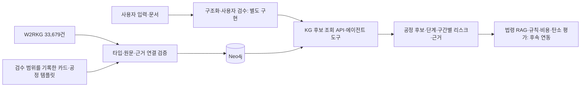

# 지식그래프 사용법

KG는 **입력한 폐자원과 관련된 공정 후보, 확인 조건, 리스크와 출처를 찾는 도구**입니다.
팀의 `Re_server` 또는 에이전트가 호출합니다. 프론트에서 Neo4j에 직접 접근하지 않습니다.

**전체 파이프라인은 [2026-10-20 기준으로 고정](pipeline-baseline.md)했습니다.**
새 흐름의 전체 후보 조회에는 `/kg/candidate-pool`을 사용합니다.
자료가 부족한 후보도 보존하고, 조건·리스크·근거를 조사 묶음으로 넘깁니다.
아래 `/kg/candidates`는 제한 조회를 유지하는 기존 계약입니다.
새 API는 [조사 묶음 사용법](kg-research-pool.md), 다음 작업은 [고도화 계획](kg-upgrade-plan.md)에 있습니다.

**2026-10-21 추가:** `POST /kg/process-plans`는 별도 출처 기반 상태 전이와 시설 역할을
연결해 여러 단계의 경로를 생성합니다. [공정·시설 경로 사용법](kg-process-plans.md)을 참고하세요.
기존의 조건부 템플릿·문헌 조회와 자료 범위가 다르며 현재 허가·인수를 입증하지 않습니다.



## 기획서와 연결되는 부분

[기획서 v3](https://app.notion.com/p/v3-3fa301db7c408092a9e6e83690f52567)의
4.2, 5.1, 5.2를 읽고 다음 경계를 적용했습니다.

| 요구사항 | 이번 구현 | 아직 필요한 것 |
| --- | --- | --- |
| 4.2 폐기물·공정·조건·현행 처리·미확인 정보 | 구조화 입력 계약, null 보존, 모르는 항목 반환 | OCR·자연어 추출, 사용자 검수 UI |
| 5.1 공정·손실 근거 | W2RKG 원본 관계, 범위가 있는 조사 카드 69개, 조건부 경로 18개 | 국내 PP·PE 스크랩 근거, 실제 성분·수율·업체 조건 검수 |
| 5.2 KG 후보 탐색 | Neo4j 저장, 소재 → 문헌 주장/조건부 공정 → 단계·구간·리스크·출처 탐색 | 법정 폐기물 코드 → 허용 재활용 유형 연결의 전문가 검수 |
| 5.2 규칙·RAG·근거 카드 | 기존 법령 RAG 보존, 카드의 출처·범위·제약을 조회 결과에 포함 | 법규 판정 규칙과 RAG 연동, 모든 수치의 값·단위·기준일 표준화 |

현행 처리는 선택 입력입니다. 모르면 `null`이며 기존 경로나 비교 기준선을 만들지 않습니다.
기획서에 적힌 손실률·가격·배출계수를 원문·적용 범위 확인 없이 기본값으로 추가하지 않았습니다.

## 실행

저장소 루트에서 실행합니다. Python 설치는 README와 같습니다.

1. `.env.example`을 `.env`로 복사하고 `NEO4J_PASSWORD`를 직접 정합니다.
2. Neo4j를 실행합니다.

```bash
docker compose -f docker-compose.neo4j.yml up -d --wait
resource-kg validate
resource-kg import
resource-kg audit
uvicorn resource_ai.main:app --reload
```

이미 로컬 7474/7687 포트에 Neo4j가 있다면 컨테이너를 새로 실행하지 말고 그 서버의
주소·계정을 `.env`에 설정합니다. `NEO4J_NAMESPACE` 기본값은 `re-ai-reference`입니다.
프로토타입의 `resource-reference`와 분리됩니다. 비밀번호는 Git에 넣지 않습니다.
통합 배포용 compose/Azure 설정은 `Re_infra` 담당 범위입니다.

원문 인덱스는 `data/knowledge_graph/`에 고정 해시와 함께 포함했습니다.
빌드 때만 격리된 메모리 SQLite로 관계·근거를 검증하고, 런타임 조회는 Neo4j만 사용합니다.
서비스 DB나 프로토타입 SQLite 파일을 전달할 필요가 없습니다. Neo4j 장애 시 503을 반환합니다.

## 입력과 출력

`POST /kg/candidates` 예시:

```json
{
  "material": "PP",
  "color": "검정",
  "quantity_kg": 3000,
  "generation_process": "사출",
  "contamination": null,
  "current_treatment": null,
  "priority": "cost",
  "top_k": 20
}
```

사용자 검수 후 소재를 정확한 별칭으로 전달합니다. PP/폴리프로필렌, PE/HDPE/LDPE/LLDPE,
PET/페트, 알루미늄, 종이류를 조회할 수 있습니다. PE 별칭은 **검색 수지군**이며
HDPE와 LDPE의 공정 적합성이 같다는 뜻이 아닙니다. 자유 문장 분류는 이 API의 역할이 아닙니다.

| 출력 | 용도 |
| --- | --- |
| `literature_candidates` | W2RKG 문헌 조사 후보, 원본 4개 필드·DOI 검색 후보·출처 기록·그래프 경로 |
| `process_candidates` | 조건부 조사 경로의 `nodes`, `edges`, `risks`, 입력 조건, 근거 ID 매핑 |
| `scoped_claims`, `evidence` | 카드 주장·적용 범위·미확인 사항·자료 위치·이용 조건 |
| `input_context`, `missing_fields` | 입력 보존과 추가 확인 항목. 입력값을 처리 가능성 판단으로 바꾸지 않음 |
| `graph_trace` | namespace, 적재 버전, 온톨로지/내용/원본 해시, 형태 필터 |

공정 템플릿은 PET·알루미늄·종이에만 있습니다. PP·PE는 현재 문헌 후보가 나옵니다.
`input_form`은 템플릿의 형태 코드(`bottle`, `flake`, `chips`, `sheet`, `can`, `cardboard`,
`cup`, `unknown`)와 정확히 비교합니다. 입력하지 않으면 `unknown` 템플릿만
조회합니다. 다른 형태로 임의 대체하지 않습니다. 자료에 해당 템플릿이 없으면 빈 목록입니다.
반환 순서는 재현 가능한 원본 순서이며 경제성·환경성 추천 순위가 아닙니다. 문헌은 `top_k`건까지 반환합니다.

에이전트에서는 같은 서비스를 호출합니다.

```python
from resource_ai.agents.tools.graph_tool import find_process_candidates

result = find_process_candidates(material="PET", input_form="bottle", top_k=10)
```

MCP 프로토콜 서버, LLM 에이전트 회의, 규칙 판정, 비용·탄소·운송 거리 계산은 아직 붙이지 않았습니다.
소재·색상·오염·지역 등의 입력은 보존하지만 현재 적합성 필터는 소재/형태 기준입니다.

## 그래프를 만든 방법

온톨로지는 패키지의 `knowledge_graph/resources/waste-resource-v1.json`입니다.
온톨로지 v1.2는 18개 노드 클래스와 19개 관계의 연결 타입·필수 속성·추론 금지 조건을 정의합니다.
새 `MaterialState`, `ProcessTransition`, `Organisation`, `Facility`, `FacilityCapability`가
공정 전이와 시설 후보를 구분합니다. 시설 연결의 출처 강도·확인일·미확인 조건을 보존합니다.
OWL 추론기가 아닌 출처를 보존하는 property graph입니다.

- 문헌 한 행을 `TransformationClaim`으로 저장하고 원본 폐기물/공정/산출물 표현과 출처를 연결합니다.
- 쉼표로 묶인 재료·공정은 나누지 않습니다. 논문의 공정 순서나 판매 가능한 제품으로 확정하지 않습니다.
- 카드의 적용 범위와 확인 질문은 `ScopedClaim`, `Condition`으로 별도 저장합니다.
- 조건부 경로는 `RouteSnapshot`, 그 경로의 단계·구간은 `StepOccurrence`, `LinkOccurrence`입니다.
- `Risk`의 `TARGETS`는 해당 경로 안의 정확한 단계/구간을 가리킵니다. 원인·대응 행동은 Risk payload에 있습니다.
- 같은 문서의 E01이나 단계 n1이 다른 경로의 근거와 섞이지 않도록 경로 내용·근거의 해시로 ID를 만듭니다.

아직 `폐기물 법정 분류`, `허용 재활용 유형`, `손실 원인`, `대응 행동`을 모두 독립된
노드로 정규화한 상태는 아닙니다. 검수된 분류·규칙 데이터가 들어오면 확장할 지점입니다.

적재는 새 세대를 만들고 실제 Bolt로 읽어 검증한 뒤 활성 포인터를 한 번에 전환합니다.
실패한 적재는 기존 활성 그래프를 바꾸지 않습니다. 같은 자료는 재적재하지 않고 감사를 실행합니다.
DB 전체 삭제나 이전 세대 자동 삭제는 하지 않습니다. 운영 시 보관·정리 정책이 추가로 필요합니다.

Neo4j Browser `http://127.0.0.1:7474`에서 활성 그래프 보기:

```cypher
MATCH (h:ReSourceGraph {space:'re-ai-reference'})
MATCH (c:ReSourceNode:TransformationClaim {space:h.space,generation:h.generation})
MATCH (c)-[r:INPUT_LABEL|PROCESS_LABEL|OUTPUT_LABEL|SUPPORTED_BY]->(n)
RETURN c,r,n LIMIT 80
```

## 검증과 자료의 한계

```bash
ruff check .
ruff format --check .
pytest -q
# 실제 Neo4j를 켜고 RUN_NEO4J_INTEGRATION=true 환경변수를 지정하면 Bolt 테스트도 실행
python scripts/evaluate_knowledge_graph.py --output kg-evaluation.json
```

단위 테스트는 원문 보존·쉼표 미분리·근거/리스크 대상 혼동·타입 오류·롤백·변조를 확인합니다.
실제 Neo4j CI는 적재·재적재·감사·API 조회와 적재 실패 시 기존 세대 보존까지 확인합니다.
이 검사는 그래프 구조와 API 회귀 검사이며 **추천 정확도나 실제 공장 적용 검증은 아닙니다.**

W2RKG 데이터셋 Apache-2.0과 논문·인용 원문의 이용 조건은 서로 다릅니다.
원본 논문·국가 LCI Excel·허가증·사용자 업로드·비밀값은 포함하지 않았습니다.
출처와 변경 이력은 `data/knowledge_graph/ATTRIBUTION.w2rkg.md`와
`knowledge_graph/resources/bundle-manifest.json`에 있습니다. 카드/기업 정보의 권리·확인일은
개별 메타데이터를 따릅니다. 외부 모델 전송은 카드의 `model_transfer_allowed`를 별도로 지켜야 합니다.
