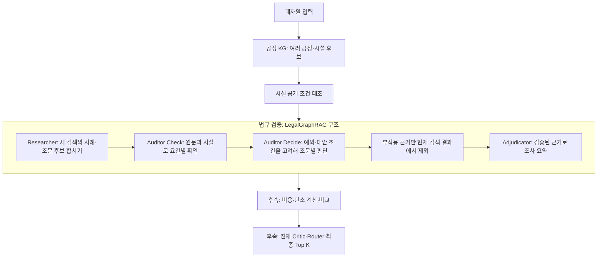

# 법률 그래프와 검증 흐름

기존 법령 RAG는 질문과 비슷한 원문을 찾습니다. 새 법률 그래프는 **관련 사례·쟁점·조문·적용 요건을 연결하고, 검색한 조문이 입력 사실에 적용되는지 따로 검토**합니다.
폐기물의 공정·시설 후보를 만드는 W2RKG와 역할이 다릅니다. 두 그래프 모두 Neo4j를 사용하지만 자료와 적재 세대를 분리했습니다.

## 우리 파이프라인에서 들어가는 곳



법률 Auditor는 법규 검증 내부의 역할입니다. 공정 경로·시설·가격·탄소까지 반박하는 **전체 Adversarial Critic**과는 별개입니다.

## 그래프에는 무엇이 있나요?

| 층 | 연결 | 의미 |
| --- | --- | --- |
| Fact | Case → CITES → Article, Case → HAS_ISSUE → Issue | 판례의 조문 참조와 규제 쟁점 |
| Ontology | Case → HAS_FEATURE → Feature, Case → BELONGS_TO → Community | 행위자·행위·대상·맥락 특징, 유사 사례 묶음 |
| Rule | Article → HAS_CHECKLIST → ChecklistItem, Article → HAS_INTERPRETATION → Interpretation | 적용 요건과 별도 공식 해석 근거 |
| 출처 | 각 노드 → RE_LEGAL_SUPPORT → 원문 구간 | 출처 URL·문서 버전·시행일·본문 SHA-256 |

모델이 생성하는 특징·쟁점·체크리스트는 추출 가설입니다. 체크리스트에는 원문 그대로의 인용과 시작·끝 위치를 붙이며, 전문가 검수 없이 완전한 요건 목록이라고 표시하지 않습니다.
별표를 평문으로 수집한 자료는 표의 행·열 관계를 복원했다고 가정하지 않고 체크리스트 자동 생성에서 제외합니다.

현재는 고정된 Neo4j 세대를 읽어 Python에서 코사인·관계 탐색을 수행합니다. 큰 말뭉치의 벡터 인덱스·분할 적재·성능 튜닝은 후속 작업입니다.

판례의 **참조조문**은 적용 확정이 아닙니다. 구법 인용, 현행 대응 조문, 정확한 적용 버전이 확인되지 않은 참조를 구분합니다.
`CITES`에 `version_resolved=false`가 붙은 판례는 최종 판단에서 검증된 적용 사례로 승격하지 않습니다. 판결요지를 별도 공식 유권해석으로 만들지도 않습니다.
같은 법령의 여러 버전을 넣으면 시행 구간을 구분해 질문 기준일의 버전만 사용합니다. 조문 번호가 같아도 다른 법령에 잘못 연결하지 않습니다.

별도 공식 해석을 확보하면 `INTERPRETATION` 문서로 넣을 수 있습니다. `version`·`effective_from`과
`metadata.article_references`의 정확한 법령 `source_id`·`article`을 지정해야 합니다. 해석의 적용 버전은 검수자가
`metadata.version_verified=true`로 확인한 것만 검증 입력에 사용합니다. 이 표시는 모델이 자동 부여하지 않습니다. 현재 실제 수집 해석은 없습니다.

## 논문을 어떻게 반영했나요?

기준은 [LegalGraphRAG 논문](https://aclanthology.org/2026.acl-long.1738.pdf)의 §4.2·§4.3·Appendix B Algorithm 1입니다.
공식 구현은 [XMUDeepLIT/LegalGraphRAG](https://github.com/XMUDeepLIT/LegalGraphRAG/tree/a3c9c3070cadb72ec317d2ecc2cce99da4b37c57)를 확인했습니다.

| 논문의 구성 | 이번 코드 |
| --- | --- |
| Fact / Ontology / Rule 계층 | 사례·특징·쟁점·조문·요건·해석 노드와 근거 연결 |
| 특징 임베딩·사례 kNN·Leiden | 실제 igraph/leidenalg 사용. k=3, seed=42. 양의 코사인 유사도 연결 |
| 세 검색의 합집합 | 특징 의미 검색 + 가장 유사한 커뮤니티 **1개** 내부 사례 검색 + 예측 쟁점→사례→조문 |
| 항목별 Check 후 별도 Decide | 요건별 응답과 조문별 종합 응답을 별도 모델 호출로 분리. 단순 AND로 판정하지 않음 |
| 부적용 근거와 종속 사례·쟁점 정리 | 실행 결과 안에서만 정리. 공용 Neo4j 원본은 삭제하지 않음 |
| 검증된 근거로 Adjudicator 판단 | 검증된 조문·적용 버전이 확인된 사례·연결된 쟁점만 최종 입력에 포함 |

중국 형사 사건의 피고인·범죄행위·피해자·고의 특징을 **행위자·행위·대상·맥락**으로, 죄명 앵커를 **규제 쟁점·의무 유형**으로 바꿨습니다.
형량·유무죄 대신 폐자원 처리의 법규 적용 조사 요약을 반환합니다. 한국 도메인에 맞춘 알고리즘 구현이며 원논문 성능의 재현을 뜻하지 않습니다.

공식 코드에는 논문과 다른 부분도 있습니다. Louvain, 최대 2개 커뮤니티 검색, NetworkX/pickle 저장 등을 사용하고,
중국 형법을 위한 낮은 조문 번호 제외 규칙도 있습니다. 이번에는 논문의 Leiden·단일 커뮤니티 검색을 따르고 Neo4j에 저장합니다.
제17·25·48조 등을 번호가 낮다는 이유로 지우지 않습니다. 커뮤니티 요약은 현재 모든 소속 사례 특징을 사용하며 대규모 대표 사례 선정은 별도 고도화 범위입니다.

공식 저장소에서 명시적인 LICENSE를 확인하지 못해 소스·프롬프트를 복사하지 않고 알고리즘을 독립 구현했습니다.

## 실제로 완료한 것과 아직 아닌 것

**2026-10-22 기준**입니다. 실제 자료와 가상 시험을 구분합니다.

| 범위 | 상태 |
| --- | --- |
| 국내 공식 원문 구조화 | 기존 수집 자료 4문서·102구간. 법령 3문서와 판례 1건 |
| 모델 없이 만드는 구조 그래프 | 조문·별표 13개, 판례 1개, 미해결 참조 7개, 관계 10개, 원문 근거 102개 |
| 특징·체크리스트·쟁점·Leiden·세 검색·Auditor·Adjudicator | 코드 구현 및 가상 응답으로 전체 흐름 테스트 |
| Neo4j | 별도 법률 namespace, 실제 노드·관계·원문 적재와 무결성·실패 시 세대 복구 검사 |
| 생성 모델 실호출 | **사용자 요청에 따라 미실행**. 기본 설정은 비활성 |
| 실제 원문에서 모델로 만든 완성 그래프 | 아직 없음. 현재 실제 자료는 구조 적재 단계 |
| 국내 법규 정확도·커뮤니티 검색 효과 | 미평가. 실제 판례 1건으로 성능을 주장할 수 없음 |
| 시설 허가·인수 승인·최종 추천 | 수행하지 않음. 전체 결과는 REVIEW 유지 |

실제 구조 적재 결과는 [검증 기록](evaluation/legal-hierargraph-2026-10-22.json)에 남겼습니다. 11개 구조·API 검사를 통과했으며 생성 모델 호출은 0회입니다.

가상 시험의 해시 임베딩과 정해진 모델 응답은 알고리즘·실패 처리 확인용입니다. 실제 의미 검색·법률 판단의 정답셋이 아닙니다.
실제 자료의 구법 본문, 적용 버전, 참조 판례 원문, 구조가 보존된 별표, 공식 해석과 추가 판례를 확보해야 합니다.

현재 판례가 참조하는 제17조 연결은 검색 단서이며 적용 버전이 미해결입니다. 제25·48조 등이 구조 그래프에 있다는 사실만으로 모든 질문에서 검색되지는 않습니다.
사례 기반 세 검색으로 연결되지 않는 조문은 법규가 없다는 뜻이 아니라 **그래프 범위의 누락**입니다. 기존 Hybrid 검색은 별도 API로 유지하며 몰래 대체 검색하지 않습니다.

## 모델 연결 전 실행

기존 공식 원문 수집과 Neo4j 설정을 먼저 준비합니다. Python 가상환경에서:

```bash
pip install -e '.[dev,embeddings]'
legal-graph import --structure-only --dataset data/official/legal_documents.jsonl
legal-graph status
uvicorn resource_ai.main:app --host 127.0.0.1 --port 8000
```

Windows에서는 각각 `.\.venv\Scripts\python.exe -m pip`, `.\.venv\Scripts\python.exe -m resource_ai.legal_graph.cli`를 사용할 수 있습니다.
`GET /legal-graph/status`의 `analysis_ready=false`는 구조만 적재된 상태입니다. 이 상태를 완성된 Agent 그래프로 보여 주지 않습니다.
모델이 미연결이면 `/legal-graph/analyze`는 `503` + `model-not-configured`를 반환합니다.

나중에 연결할 때만 서버의 `.env`에서 다음을 설정합니다. 키는 채팅·요청 본문·Git에 넣지 않습니다.

```dotenv
LEGAL_GRAPH_NAMESPACE=re-ai-legal
LEGAL_GRAPH_MODEL_ENABLED=true
LEGAL_GRAPH_ALLOW_EXTERNAL=true
LEGAL_GRAPH_MODEL=solar-pro4
UPSTAGE_API_KEY=
```

두 활성화 설정은 모델 사용과 공식 근거·입력 사실의 외부 전송을 명시적으로 켜는 값입니다.
모델 어댑터는 [Upstage 공식 Chat API](https://console.upstage.ai/api/chat)의 JSON 응답을 받아 로컬 스키마로 다시 검사합니다.
키 입력 후 `legal-graph import --enrich --max-model-calls 100`으로 **특징·요건 생성까지 성공한 새 세대**를 적재해야 전체 분석이 가능합니다.
완성 그래프를 구조 전용 적재로 교체하면 다시 `analysis_ready=false`가 되므로 옵션을 확인하세요.

## API 사용

단독 법규 조사: `POST /legal-graph/analyze`

```json
{
  "query": "해당 PP 스크랩을 외부 시설에 위탁하기 전에 확인할 법적 조건은?",
  "facts": {"material": "PP", "quantity_kg": 3000, "as_of": "2026-10-22"},
  "top_k": 5,
  "max_model_calls": 40,
  "max_articles": 20
}
```

`facts`는 사용자가 제공한 사실이며 공적 증명의 확인을 뜻하지 않습니다. 빠진 사실은 그대로 부족 상태로 둡니다.
원문 인용 ID 검사는 인용이 실제 법적 판단을 뒷받침한다는 의미적 정확도까지 증명하지 않습니다.

공정 후보와 연결: 기존 `POST /analysis/research`에 선택 필드 `legal_graph`를 넣습니다.

```json
{
  "lot": {"material": "PP", "input_form": "scrap", "quantity_kg": 3000},
  "legal_graph": {
    "query": "후보별 위탁·재활용 법규 적용 조건을 확인해 주세요.",
    "facts": {"material": "PP", "as_of": "2026-10-22"},
    "max_model_calls": 40
  }
}
```

후보의 `legal_graph_review`에 검색·항목별 확인·조문 판단·요약·그래프 버전·호출 기록이 붙습니다.
전체 후보가 하나의 모델 호출 한도와 하나의 고정 법률 그래프 세대를 공유합니다. KG의 공정 순서는 `proposed_route`라는 **가설**로 전달하며 실제 수행·허가 사실로 사용하지 못하게 구분합니다.
`legal_graph`를 생략하면 기존 로컬 Hybrid RAG 흐름과 계약을 유지합니다. 생성 모델을 기본 경로로 자동 활성화하지 않습니다.

## 오류가 나면

| 상황 | 처리 |
| --- | --- |
| 사실 부족·잘못된 응답·허용되지 않은 근거·호출 한도 | 해당 검증을 unknown으로 남김. 부적용으로 지우지 않음 |
| 원문과 다른 인용·구간·시행일 | 요건 검증 차단 |
| 미래 시행 조문·미래 판례 | 해당 기준일의 검증 입력에서 제외 |
| 필요한 구법 버전·해석 미확인 | 확인 필요로 보류 |
| 미검증 조문을 최종 답변이 인용 | 답변을 채택하지 않고 REVIEW |
| Neo4j 변조·실패·미적재 | 명시적 오류. 가상 그래프나 Hybrid 검색으로 자동 전환하지 않음 |

다음 순서는 **추가 판례·구법·별표·공식 해석 확보 → 생성 모델 연결 및 그래프 보강 → 전문가 정답셋 → 기존 Hybrid와 검색·적용성 비교**입니다.

구조 검증은 `python scripts/evaluate_legal_graph.py --output legal-graph-evaluation.json`, 가상 모델 회귀는
`pytest tests/unit/test_legal_hierargraph.py tests/unit/test_candidate_legal_graph.py`, 실제 Neo4j 회귀는
`RUN_NEO4J_INTEGRATION=true` 환경에서 `pytest tests/integration/test_legal_graph_neo4j.py`로 실행합니다.
