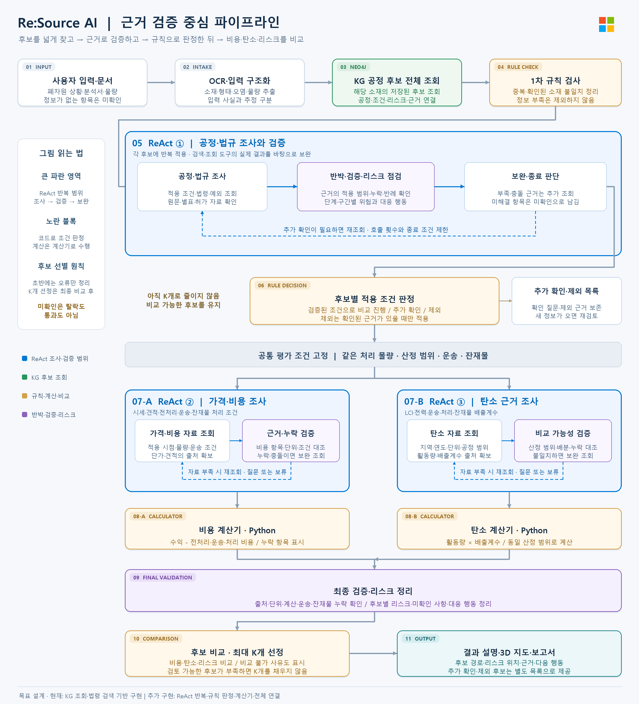

# 확정한 전체 파이프라인

이 문서는 이전 설계 기록입니다. 현재 기준은 [공정·시설 추천 v2](pipeline-baseline.md)입니다.

기준: **2026-10-20-fixed-v1**. 아래는 만들기로 확정한 목표 구조입니다.
그림의 모든 단계가 구현됐다는 뜻은 아닙니다.

## 처리 순서

1. 사용자가 폐자원 상황과 문서를 입력합니다. 기존 처리 방식을 모르면 비워 둡니다.
2. OCR·추출로 소재·형태·오염·물량을 정리하고, 입력 사실과 추정을 구분합니다.
3. KG에서 해당 소재의 **저장된 후보를 넓게 조회**합니다. 이 단계에서 상위 K개를 고르지 않습니다.
4. 첫 규칙 검사는 중복·확인된 소재 불일치만 정리합니다. 정보 부족은 제외 사유가 아닙니다.
5. **ReAct ①** 안에서 공정·법규 조사 → 반박·검증·리스크 점검 → 보완 조회를 반복합니다.
6. **후보별 적용 조건 판정**으로 비교 진행 / 추가 확인 / 근거 있는 제외를 구분합니다.
7. 비교를 진행할 후보에 대해 **ReAct ② 비용 조사**, **ReAct ③ 탄소 근거 조사**를 수행합니다.
8. Python 계산기로 비용과 탄소를 계산합니다. 같은 물량·산정 범위·운송·잔재물을 비교합니다.
9. 출처·단위·계산·누락을 검증하고, 단계·구간별 리스크와 대응 행동을 정리합니다.
10. 비용·탄소·리스크를 비교해 **최대 K개**를 제시합니다. 부족하면 억지로 채우지 않습니다.
11. 경로·리스크 위치·근거·다음 행동을 3D 지도와 보고서로 보여 줍니다.

## 바꾸지 않을 원칙

- ReAct는 위 조사·검증·보완을 묶는 큰 반복 범위입니다. 한 번의 모델 호출을 뜻하지 않습니다.
- 바깥 실행 순서와 중단 조건은 코드로 정합니다. 합의를 위한 에이전트 토론은 기본 구조가 아닙니다.
- KG가 연결됐다고 실제 공정 적용·국내 허가·업체 인수가 증명된 것은 아닙니다.
- **미확인 ≠ 탈락 ≠ 통과**입니다. 조사 질문을 검증된 제외 규칙으로 사용하지 않습니다.
- 가격·탄소 자료가 없으면 순위를 억지로 계산하지 않고, 비교 불가 사유를 남깁니다.
- 사용자 우선순위를 임의의 가중치로 넣는 단계는 없습니다.

## 지금 구현한 부분

- KG 원본·조건부 경로·근거의 Neo4j 적재·조회.
- 페이지를 끝까지 따라가며 후보 전체를 조회하는 `/kg/candidate-pool`.
- 각 후보의 적용 조건·공정 단계·리스크·근거·미확인을 전달하는 조사 묶음.
- 기존 법령 Hybrid Search.

OCR, ReAct 실행기, 두 규칙 단계, 비용·탄소 계산기, 최종 비교, 서비스 화면 연결은
이 문서만으로 구현되지 않습니다. [KG 고도화 계획과 실행 결과](kg-upgrade-plan.md)에 경계를 기록합니다.
