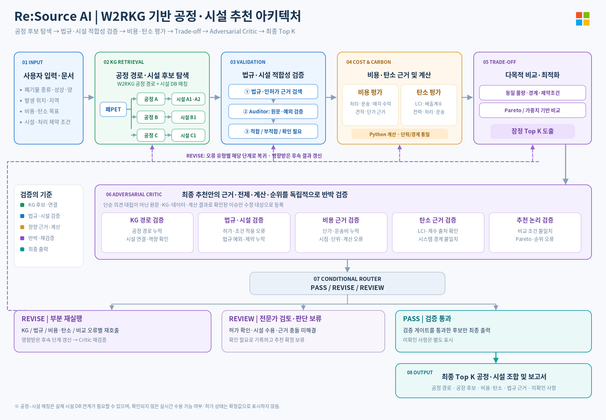

# 전체 아키텍처 기준

현재 목표: **2026-10-20-design-v2 — W2RKG 기반 공정·시설 추천**.
사용자가 제공한 아래 그림을 전체 서비스의 새 기준으로 기록합니다.
이 문서는 목표 설계이며, 모든 단계가 구현됐다는 뜻은 아닙니다.
이전 ReAct 상세 흐름은 [v1 기록](pipeline-baseline-v1.md)에 보존했습니다.

## 처리 순서와 역할

| 단계 | 할 일 | 경계 |
| --- | --- | --- |
| 01 입력 | 종류·성상·양·위치·목표·제약과 문서를 구조화 | 기존 처리 방식이나 미확인 성분을 추정하지 않음 |
| 02 KG 탐색 | 문헌·조건부 공정 경로를 조회하고 처리 단계에 시설 후보를 연결 | W2RKG와 별도의 시설 자료가 필요. 연결됐다고 인수 가능하다는 뜻이 아님 |
| 03 법규·시설 적합성 검증 | 근거 검색 → Auditor의 원문·예외 검증 → 적합/부적합/확인 필요 | 확인 필요를 탈락·통과로 바꾸지 않음. 자동 판정은 검수된 조건에만 적용 |
| 04 비용·탄소 | 단가·견적·LCI·배출계수 조사 후 Python 계산 | 동일 물량·단위·경계·운송·잔재물을 적용. 자료 부족은 비교 불가로 표시 |
| 05 Trade-off | Pareto 또는 명시된 가중치 기준으로 비교하고 잠정 Top K 추출 | 이때는 확정 추천이 아님. 기준·가중치·누락 후보·미확인을 보존 |
| 06 Adversarial Critic | KG·법규/시설·비용·탄소·추천 논리를 독립 검증 | 출처·데이터·계산으로 오류를 지적. 단순 찬반 토론으로 결론내리지 않음 |
| 07 Router | PASS / REVISE / REVIEW 분기 | 분기·재시도 한도·후속 결과 무효화는 코드로 제어 |
| 08 출력 | 검증을 통과한 최대 K개 공정·시설 조합과 보고서·지도 | 부족하면 K개를 억지로 채우지 않음. 확인 필요·제외 사유도 별도 표시 |

조사 단계 내부의 검색·검증·보완 반복에 ReAct를 사용할 수 있습니다.
ReAct가 전체 단계 순서·계산·분기 규칙을 임의로 바꾸게 하지는 않습니다.

## Critic과 재실행의 약속

- Critic에는 잠정 Top K뿐 아니라 **전체 후보 목록·탈락/보류 사유·비교표**도 전달합니다.
  그래야 좋은 후보를 누락했는지 확인할 수 있습니다.
- 지적은 `candidate_id`, 단계/구간 ID, `evidence_id`, 오류 유형, 원인 단계와 함께 남깁니다.
  이 형식은 후속 구현 제안이며 현재 실행 API가 아닙니다.
- KG 오류는 02부터, 법규·시설 오류는 03부터, 수치·경계 오류는 04부터,
  비교 오류는 05부터 다시 처리하고 **영향받은 뒤 단계의 결과를 갱신**합니다.
- 수정 후에는 Critic을 다시 실행합니다. 재시도 한도를 넘거나 핵심 근거가 해결되지 않으면 REVIEW입니다.
- 잠정 후보가 검증에서 빠지면 전체 풀의 다음 후보도 검토합니다. 순위표만 당겨 최종 통과시키지 않습니다.
- PASS는 검증 절차 통과를 뜻합니다. 법적 승인·시설의 실시간 수용 확인을 대신하지 않습니다.
  핵심 허가·인수·근거 충돌이 미해결이면 REVIEW로 남깁니다.

## 지금 구현한 부분과 남은 부분

구현: Neo4j 원본·조건부 경로·근거 적재, 전체 후보 페이지 조회, 조건·리스크·출처 조사 묶음,
그래프 버전·근거 연결 검증, 기존 법령 Hybrid Search.

2026-10-21 추가: 별도 공개 자료 기반 상태 전이·시설 후보 DB와 `/kg/process-plans` 경로 탐색.
범위와 가설 구분은 [공정·시설 경로 API](kg-process-plans.md) 참고.

미구현: 시설의 현재 허가·수용 검증, Auditor/ReAct 실행기, 적합성 판정,
비용·탄소 계산, Trade-off, 최종 Critic·Router와 부분 재실행, 전체 화면 연결.
일부 템플릿의 `facility_candidate_ids`는 공개 사업 사례 ID이며 실시간 시설 DB가 아닙니다.

기존 KG 응답의 `graph_trace.pipeline_baseline=2026-10-20-fixed-v1`은 KG 기반 구현 당시의
추적 표식입니다. 새 전체 파이프라인이 실행됐다는 의미가 아니며, 이 문서 변경으로 API 값을 바꾸지 않습니다.
전체 실행기의 설계 버전·실행 버전은 후속 연동에서 구분해 관리해야 합니다.

다음 KG 작업은 [고도화 계획](kg-upgrade-plan.md)에 기록합니다.
