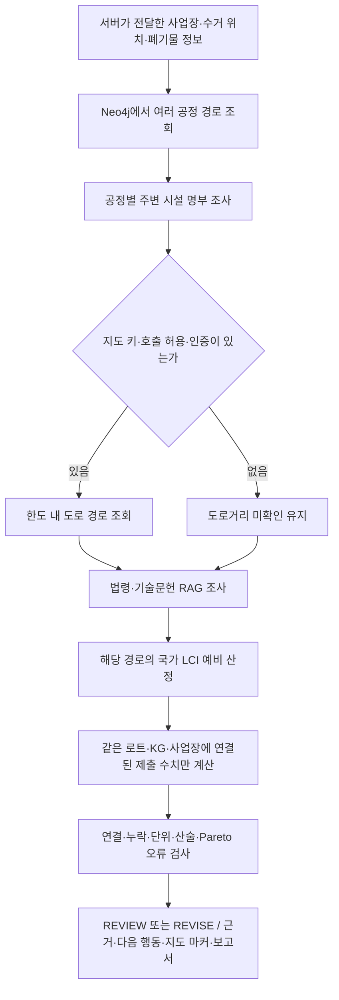

# 실제 DB로 돌려 본 전체 흐름

2026-10-25 로컬 검증 기록입니다. **사업장·폐기물 로트·가격은 가상**, KG·공개 법령·시설 명부·로컬 LCI 파일은 실제 자료입니다.
실제 고객의 처리 사례, 허가 확인, 계약 견적, 전체 서비스 배포 시험은 아닙니다.

## 먼저 확인한 팀원 PR

조직의 PR 36개를 확인했습니다. Re_ai 25개(병합 20·열림 5), Re_server 9개, Re_client·Re_infra 각 1개입니다.
상태·본문·변경 범위를 확인하고, 최근 AI 변경의 실제 diff와 연결되는 서버 계약을 우선 검토했습니다.
과거 35개 PR의 모든 줄을 새로 보안 감사했다는 뜻은 아닙니다.

| 변경 | 이번 처리 |
| --- | --- |
| AI [#36](https://github.com/resource-ai-team/Re_ai/pull/36) | 법령 수집 v2 범위를 유지: 법령 15종·판례 12건 |
| AI [#38](https://github.com/resource-ai-team/Re_ai/pull/38), [#42](https://github.com/resource-ai-team/Re_ai/pull/42), [#44](https://github.com/resource-ai-team/Re_ai/pull/44) | LEGAL/TECHNICAL/COMPANY 그룹, 출처 위치·버전, 그룹 내 벡터 검색을 현재 브랜치에 통합 |
| AI [#40](https://github.com/resource-ai-team/Re_ai/pull/40) | 동료의 한국어 주석 정리를 보존 |
| AI [#46](https://github.com/resource-ai-team/Re_ai/pull/46) | 마지막 재확인에서 추가 병합 확인. technical 분류 12문서만 남기고 factory·recipient 21문서를 현재 RAG 검색에서 제외. 원본 행은 보존 |
| 열린 AI #24·#26·#29·#30 | 법률 그래프·경로 검토·LCI를 로컬 검증 브랜치에서 함께 실행. GitHub 병합과 구분 |
| 열린 AI [#23](https://github.com/resource-ai-team/Re_ai/pull/23) | 개발용 KG 탐색기. 충돌 상태이며 이번 엔진 통합에는 포함하지 않음 |
| 서버 [#10](https://github.com/resource-ai-team/Re_server/pull/10), [#12](https://github.com/resource-ai-team/Re_server/pull/12), [#14](https://github.com/resource-ai-team/Re_server/pull/14) | 회사 ID·회사 프로필·오류 형식 확인. 본사 주소를 공장 수거 위치로 사용하면 안 됨 |

최종 반영한 develop 기준은 `6fddb2c`입니다. 과거 AI PR #2·#3·#5·#7·#9·#11·#13·#15·#17·#19·#21·#27·#31·#33은
[이전 점검](pr-audit-2026-10-24.md)과 이번 통합 회귀 검사를 함께 참고합니다.
서버의 나머지 PR #1·#2·#3·#5·#6·#8은 초기화·회원/인증·배포 구성 변경을 확인했습니다.
클라이언트·인프라의 CI PR만으로 웹→서버→AI 통합이 완성됐다고 판단하지 않았습니다.

## 지금 한 번에 실행되는 흐름

`POST /analysis/site-review`는 아래 단계를 묶는 **내부 조사 API**입니다.



- 주변 시설 명부 행을 공정 수행이 입증된 시설로 자동 교체하지 않습니다.
- 도로 API는 구현됐지만 키가 없어 이번 실제 호출은 0회입니다. 직선거리를 도로거리로 바꿔 표시하지 않습니다.
- LCI는 예비 산정입니다. 시설별 총배출량·총비용·Pareto에 자동 합산하지 않습니다.
- 기술문헌을 검색했어도 실제 로트 적용성은 검수해야 합니다. 검색 누락·한도 소진도 단계별 확인 과제로 반환합니다.
- 숫자를 비교하려면 먼저 `/analysis/site-discovery`의 `context_sha256`과 `/analysis/review-template`의 경로 양식을 받아 근거를 채웁니다.
  새 사업장 맥락과 다르면 그 숫자를 제외합니다. 해시는 인증·실제 수거 위치 확인을 대신하지 않습니다.
- 현재 최종 Top K·PASS·발주 승인은 없습니다. 의미적 Auditor 전체 실행도 이번 검증에 포함하지 않았습니다.

## 돌려 본 사례와 발견한 문제

69개 HTTP 시나리오와 338개 세부 검사를 실행합니다. 통과/실패의 원자료는
[시나리오 검사 기록](evaluation/pipeline-matrix-2026-10-25.json)에 있습니다.
기대 HTTP 응답은 69건 모두 일치했고 세부 검사는 **336/338 통과**입니다. 남은 두 실패는 같은 허가 질문의 검색 문제입니다.
별도 전체 코드 테스트는 실제 Neo4j·PostgreSQL을 켜고 **772개 + subtest 24개 통과·skip 0개**, Ruff·format도 통과했습니다.
[테스트 기록](evaluation/pipeline-tests-2026-10-25.json)과 [Neo4j 감사](evaluation/kg-audit-2026-10-25.json)를 함께 참고하세요.
이 매트릭스의 소재별 조사·묶음 요청은 법령 3회·기술 3회로 제한했습니다. 전체 KG 경로 조회와 모든 쟁점 조사 완료는 다릅니다.
한도 밖 질의는 `budget_exhausted`로 보존하며, 기술 적용성·법규 적용성 검수 완료로 표시하지 않습니다.

| 영역 | 시험 내용 | 확인한 결과 |
| --- | --- | --- |
| 소재·형태 | PP·PE·PET·알루미늄·종이 × 일치/미입력/다른 형태/미지원 형태 | 확인된 형태 기준 경로 수는 3·3·2·1·1. 기존 처리 경로를 추정하지 않음 |
| 입력 오류 | true/false, 0, 음수, 과도한 물량, NaN·Infinity | 422 응답. 원래 일부는 1kg로 바뀌거나 500이 발생했던 문제 수정 |
| 조사 | 다섯 소재의 전체 KG 페이지·법령·기술문헌·리스크 | 실제 로컬 DB로 실행. 근거 존재와 적용성 검증을 구분 |
| 수치 | 실제 KG ID + 가상 단가·계수 | 가상 표시를 유지하고 산술만 비교 |
| 잘못된 수치 재사용 | 다른 로트·KG·사업장, 사업장 맥락 제거, 만료·누락 근거, 다른 탄소 방법·단위, 운송 누락·가짜 단계 | 해당 수치를 제외하거나 REVISE. 자료 부족을 0으로 바꾸지 않음 |
| 여러 사업장 | 같은 가상 회사에 서로 다른 사업장 2곳 | 위치가 바뀌면 맥락 해시 변경. 공정별 시설 명부는 실제 조회 |
| 묶음 실행 | PP·PET의 site-review | 사업장·조사·LCI의 KG 세대를 대조. 보고서와 지도 대상 ID 반환 |
| LCI | 다섯 소재와 물량 미입력 | PET의 정확히 매핑된 1개 경로만 예비값. 소각 계수를 재활용 공정에 대신 쓰지 않음 |
| 법령 검색 품질 | 검수 질문 7개, Top 5 | **6/7**. 허가 업종·범위 질문에서 핵심 제25조를 놓침. 본문 언급뿐 아니라 반환한 인용 위치도 검사 |
| 법령 추가 표현 | 같은 주제를 다른 말로 묻는 8개 질문 | **5/8**. 허가 업종·위탁 확인·순환자원 인정의 기본 조문 누락. 개발자 작성 점검셋이며 전문가 정답 검수는 미완료 |
| 외부 전송 | 생성 모델·지도 비활성 설정 | 이번 시나리오 실행의 외부 모델·지도 호출 0회 |

첫 실행의 ‘소재마다 경로가 2개 이상이어야 한다’는 검사는 알루미늄·종이의 데이터 부족을 드러냈습니다.
최종 기록은 **근거 경로 존재 검사**와 **대안 부족 경고**를 나눕니다. 없는 경로를 추가해 통과시키지 않았습니다.

[추가 표현별 실제 검색 결과](evaluation/retrieval-paraphrases-2026-10-25.json)도 보존했습니다.
조문 묶음 검색도 비교했지만 기존 질문 6/7·추가 표현 5/8에서 개선을 입증하지 못해 기본 검색에 채택하지 않았습니다.
현재는 조문 회수·원문 적용성의 미완료를 전제로 REVIEW를 반환합니다. 이 점을 해결하기 전 법규 자동 통과를 켜면 안 됩니다.

## 실제로 보강한 부분

1. 오래된 활성 KG를 v1.2 참조 자료로 다시 적재하고, 오래된 PostgreSQL에 누락된 마이그레이션을 적용했습니다. 기존 세대와 데이터는 삭제하지 않았습니다.
2. 공식 API에서 v2 법령·판례 27문서, 2,920구간을 수집·인덱싱했습니다. 기존 추가 판례 2건도 유지했습니다.
3. 공개 근거 요약 33문서를 처음 적재한 뒤, 동료 PR #46에 맞춰 기술 분류 12문서·24청크만 현재 TECHNICAL 검색에 남겼습니다. 시설·수취처 자료는 KG·업무 DB 영역으로 분리했습니다. 오래된 factory/recipient JSONL을 다시 적재해 기술 검색에 복귀시키는 것도 차단했습니다. 원문 논문 전체를 수집한 것은 아닙니다.
4. 국가 시설 명부 9,604건과 보유 LCI 원본 7개를 로컬에 연결했습니다. 원본 업체 명부·제한된 LCI ZIP·비밀값은 Git에서 제외했습니다.
5. 검색 결과의 문서 버전·페이지·원문 위치를 조사 응답까지 보존합니다. 로컬 임베딩에 제목·구획 맥락을 넣고 키워드 검색에 구획·인용 위치를 보강했습니다.
6. 수량의 bool·무한값·과도한 값 처리와 422 오류 응답을 수정했습니다. 유효 범위는 `0 < quantity_kg <= 1e12`입니다.
7. 사업장 맥락을 수치 양식·검토에 연결했습니다. 다른 위치에서 계산한 운송 수치 재사용을 막는 범위 검사이며, 원문 거리의 진위는 별도입니다.
8. Windows의 `localhost` 접속 지연을 확인해 로컬 DB 기본값을 `127.0.0.1`로 바꿨습니다. 연결 측정은 약 5.06초→0.026초였습니다.
9. 경로가 하나뿐인 경우 대안 자료 보강 필요를 표시하고, 기술 근거 미완료·적용성 미확인도 지도 대상 단계에 연결했습니다.

현재 로컬 검색 자료는 법령 15 + 판례 14 + 기술 요약 12 = **41문서·3,385청크**입니다.
[현재 활성 자료 집계](evaluation/runtime-data-2026-10-25.json)에는 검색에서 제외한 시설·수취처 21문서도 별도로 기록했습니다.
KG의 원본 W2RKG 주장 33,679건과 국내 조건부 공정 전이 18개·시설 수행 연결 18개·참조 시설 8개는 별개입니다.
국가 명부 9,604행이 모두 공정 수행 연결 9,604개가 된 것은 아닙니다.

## 아직 부족한 것: 데이터와 기술을 분리

| 우선순위 | 데이터에서 필요한 것 | 기술에서 필요한 것 | 완료 판단 |
| --- | --- | --- | --- |
| 1 | 실제 공장의 확인된 수거 게이트, 시설의 수행 공정·투입 규격·현행 허가·인수 물량/시기 | Re_server의 다중 사업장·권한 검증, 시설 신원/수행 근거 대조 | 가까운 업체 목록과 실제 수탁 가능한 시설을 구분 |
| 2 | 독립 검수한 법규 질문·정답 조문·예외 사례 | 조문 단위 검색·재정렬 개선 및 별도 평가셋, 법률 Auditor 전체 품질 평가 | 현재 놓치는 제25조 포함, 미확인을 적법으로 통과시키지 않음 |
| 3 | 실제 처리·매각·운송 견적, 지도 키, 공정별 활동량·수율·잔재물 | 선택한 시설 사이의 모든 구간 연결·실도로 검증·수치 근거 바인딩 | 위치·물량·경로 변경 시 실제 비용 재계산 |
| 4 | 같은 방법·경계의 공정 LCI, 평가 시점·단위·지역 검수 | 전체 물질수지·운송 포함 계산과 비교 가능성 검증 | 예비 LCI값을 시설별 전체 탄소 순위로 오인하지 않음 |
| 5 | 알루미늄·제지의 추가 공정/시설 근거 | 대안 범위 표시·근거 없는 경로 생성 차단 | 여러 경로의 근거 있는 비교 |
| 6 | 실제 사용자 문서·검수 정답·처리 회신 | OCR 입력, 영구 실행 이력·부분 재시도·PASS/Top K 게이트·3D 실연동 | 웹→서버→AI→지도→확인 기록을 실제 요청으로 검증 |

서버 회사 프로필의 `head_office_address`는 수거 위치가 아닙니다. 서버의 `{code,message,details}` 오류 계약과
AI 내부의 `detail` 계약도 어댑터에서 맞춰야 합니다. 모델 연결 성공은 법규 판단·추천 정확도 검증과 구분합니다.

## 재실행

```powershell
.\.venv\Scripts\resource-rag.exe init-db
$env:RUN_NEO4J_INTEGRATION='true'
$env:RUN_POSTGRES_INTEGRATION='true'
.\.venv\Scripts\python.exe -m pytest -q
.\.venv\Scripts\python.exe -m scripts.evaluate_pipeline_matrix --output pipeline-matrix.json
.\.venv\Scripts\python.exe -m scripts.evaluate_retrieval_paraphrases --output retrieval-paraphrases.json
```

실제 시나리오에는 Neo4j 활성 KG·명부, pgvector 법령·기술문헌 인덱스, 캐시된 E5 모델과 로컬 LCI 파일이 필요합니다.
스크립트는 모델·지도 호출을 비활성화합니다. **검색 품질 실패를 포함하면 종료 코드가 1**이므로, 코드 테스트 성공과 혼동하지 마세요.
`init-db`는 기존 마이그레이션과 동료의 `004_cleanup_technical_corpus.sql`, 새 `005_heading_search.sql`을 적용합니다.
기존 청크에 제목 맥락을 반영하려면 검증된 전체 데이터셋을 다시 인덱싱해야 합니다. 공개 기술 요약은 `resource-rag build-public-evidence`로 새 범위에 맞춰 재생성합니다.
