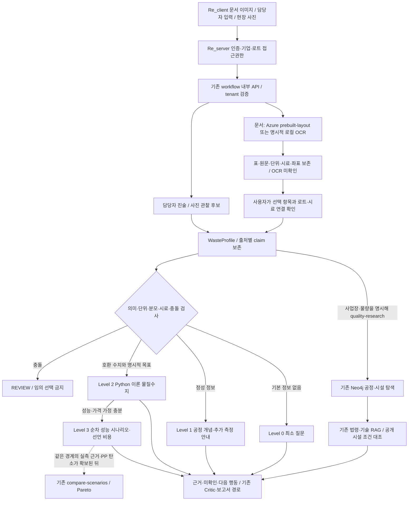

# PP 자료 기반 분석 MVP

국내 제조기업의 **경질 PP** 자료를 받아, 지금 무엇까지 계산할 수 있는지 구분하는 확장입니다.
기존 다소재 KG·RAG·후보 조사와 비용·탄소 API를 유지합니다. 이 확장만으로 최종 추천·인수·법적 승인을 만들지 않습니다.

## 사용 흐름



실행 가능한 별도 화면은 `Re-Prototype/demos/pp-preprocessing/index.html`입니다.
최종 서비스 UI와 인증은 각각 **Re_client / Re_server**의 책임입니다. Re_ai에는 새 회원·기업 DB를 추가하지 않았습니다.
프로토타입의 기존 로컬 인증 프록시로 내부 API를 검증하며, 실제 Re_server와의 배포 연결 완료를 뜻하지 않습니다.

## 기존 것과 추가한 것

| 영역 | 재사용 | 이번 확장 |
| --- | --- | --- |
| 저장·접근 | 기존 PostgreSQL case/document/revision, tenant·멱등키 | 같은 case에 quality claims·확인 이력·시나리오 저장 |
| OCR | 기존 Azure Layout REST·차단 설정·중복 호출 보호 | 표·셀·좌표 보존, 문서 분류, 주입 가능한 Mock, Windows 로컬 이미지 OCR |
| 입력 | 기존 문서 업로드·원본 SHA-256 | OCR·진술·사진 입력 구분, WasteProfile, 시료별 검증 |
| 후보 조사 | 기존 Neo4j·시설 대조·법령/기술 RAG | quality-research가 호환 프로필을 기존 SiteReviewRequest로 명시적으로 연결 |
| 계산 | 기존 시나리오 비교·Pareto API 유지 | PP 두 성분 물질수지, 건조 물질수지, 단계별 전진 계산 |
| 가격 | 기존 9월 원본 재사용 | 실제 확보한 10월 CSV·해시·품목/지역/월 일치 Loader |
| 탄소 | PET LCI 유지 | PP 계수 미확보 → null, PET로 대체하지 않음 |

`origin/develop` c210b5c는 작업 브랜치의 조상으로 이미 포함돼 있습니다. 필수 8개 문서를 읽었고 해시를 감사 기록에 남겼습니다.
Draft PR #54의 데이터 3개 파일을 같은 경로로 필요한 만큼 재사용했습니다. **PR을 승인·병합하지 않았습니다.**
10월 가격 확보 후 PR의 자료 목록에 해당 상태만 갱신했습니다.

## 입력 계약

`WasteProfile`은 `material_quality/models.py`의 타입을 따릅니다.

| 필드 | 타입·단위 | 모를 때 | 출처 |
| --- | --- | --- | --- |
| tenant_id, lot_id | 문자열 | 서버 인증/기존 case ID | Re_server가 검증한 tenant, 엔진 case |
| sample_id | 문자열 | null | 사용자 확인한 로트 시료 연결 |
| material, material_form | 문자열 | null | 확인된 문서 또는 담당자 진술 |
| quantity_kg | Decimal·kg | null | 동일 로트 수량 |
| generation_process | 문자열 | null | 담당자/문서 |
| contamination, moisture | Decimal·wt%, 습윤 질량 기준 | null | 호환되는 동일 시료 claim |
| composition | 객체 | 빈 객체 | 현재 통합 프로필은 총 비PP 기반 2성분 모델. 세부 조성은 별도 해외 예시 계산에만 있음 |
| measurements | QualityClaim 배열 | 빈 배열 | 원문·측정항목 모두 보존 |
| observed_impurities | 문자열 배열 | 빈 배열 | 정성 관찰·진술 |
| input_sources | 자료/claim 연결 배열 | 빈 배열 | 업로드 종류·해시·상태, claim 출처 |
| unknown_fields, conflicts, user_confirmations | 배열 | 빈 배열 | 코드 검증·선택 확인 이력 |

각 `QualityClaim`은 evidence_id, source_type, raw_value, normalized_value, text_value, unit,
basis, meaning, qualifier, test_method, sample_id, measurement_date, document_id, page,
bounding_region, extraction_confidence, verification_status, same_lot_confirmed, assumptions, synthetic을 보존합니다.
계산에 쓸 수 없는 용출·물성 측정값도 버리지 않고 `other_measurement`로 보존합니다.

`document_extracted_unconfirmed` → **선택 항목 확인 API** → `document_user_confirmed`입니다.
이것은 전사 내용과 시료 연결을 확인한 것이며, 공인 성적의 과학적·법적 타당성 인증이 아닙니다.
담당자 값은 계속 `operator_reported`, 사진 관찰은 `photo_observed`, 문헌 가정은 `literature_assumption`입니다.
직접 입력 API로 확인된 문서 값을 사칭할 수 없습니다. 기존 evidence ID의 값을 덮어쓰지 않고 새 ID를 추가합니다.
충돌을 자동 해소하는 기능은 없습니다. 실제 시료·원문 확인 후 별도 검토 건으로 재평가할 수 있습니다.

## 입력 수준별 결과

| Level | 조건 | 실행 결과 |
| --- | --- | --- |
| 0 | 소재 또는 경질 형태 미확인 | 우선 소재·형태 질문. 정량 계산 없음 |
| 1 | PP·경질 형태 확인 | 선별·파쇄·세척·건조 개념, 부족한 자료 안내. 실제 시설 조회와 구분 |
| 2 | 같은 로트·시료의 호환 수치 + 명시적 목표 | 이론적 제거 하한 / 건조 물질수지. 진술·가정은 그대로 표시 |
| 3 | 제거율·PP 손실·판매가·전처리/운송/잔재 비용 가정 | 여러 전진 시나리오·선언 비용·손익분기. PP 탄소 없으면 비용–탄소 Pareto 보류 |

Level과 신뢰도는 별개입니다. 가상 입력은 Level 3이라도 `simulation`입니다.
소재·질량·오염률이 충돌하면 REVIEW이며 어느 값도 선택해 계산하지 않습니다.

숫자 예시(**전부 synthetic**): 1,000 kg, 총 비PP 20 wt%, 가상 목표 5 wt%, PP 손실 0인 이상적 조건이면
최소 오염물 제거량은 약 **157.895 kg**, 산출 질량 상한은 **842.105 kg**입니다.
실제 선별기가 달성할 수 있다는 예측이 아닙니다. 개별 PVC·중금속·유해성·냄새·물성 조건도 검사한 것이 아닙니다.
수분 12→1 wt%는 고형물 손실 없음 가정에서 제거할 물 약 **111.111 kg**입니다. 에너지는 계산하지 않습니다.

## 계산 경계

- Python Decimal로 계산합니다. LLM이 계산값이나 기본 수율을 만들지 않습니다.
- 총 비PP 모델은 **오염물 질량/습윤 전체 질량** 분모만 사용합니다. mg/L 용출을 wt%로 환산하지 않습니다.
- 불검출은 null + not_detected, `<0.1`은 상한 qualifier로 보존하며 정확한 점값처럼 쓰지 않습니다.
- 서로 다른 시료의 측정값을 합치지 않습니다. `%`만 있고 질량 분모가 불명확하면 계산 대상에서 제외합니다.
- 단계별 제거율은 그 단계에 들어온 오염물 질량 기준, PP 손실률은 그 단계 PP 질량 기준입니다.
- 총 PP 손실과 그 안에 포함된 단계 손실을 동시에 받으면 거부합니다. TNO 수치는 자동으로 설정하지 않습니다.
- 건조와 총 비PP 제거는 별도 모델입니다. 건조가 PP 순도나 기름 제거를 보장하지 않습니다.
- 단계 성능 계산의 충족 표시는 총 비PP 항목만 뜻합니다. 다른 규격 항목·법규·인수는 미검증입니다.
- 비용은 선언한 전처리+운송+잔재물 처리−산출물 매출입니다. 추가 비용이 빠져 있으면 전체 현장 원가가 아닙니다.
- 기존 처리비가 없으면 절감액을 만들지 않습니다. 원점 손익분기와 기존안 대비 차이는 구분합니다.
- 기존 `calculators/scenarios.py`가 동일 경계의 비용·탄소 비교를 담당합니다. 새 PP 비교는 탄소를 만들어 그 경로를 우회하지 않습니다.

## 규격과 데이터

목표에는 지역·버전·형태·적용 대상·요구사항 종류·원본·유효일·한도를 보존합니다.
국내 기본 오염률 기준은 없습니다. 구매자 요구사항/명시적 가상 목표를 사용자가 선택해야 합니다.

| 자료 | 실제 확보 상태 | 쓰는 범위 |
| --- | --- | --- |
| KECO 2026-09 | 기존 1,672 bytes 재사용 | 중복 수집 안 함 |
| KECO 2026-10 | **CSV 다운로드 성공**, 1,730 bytes, 26개 품목×8권역 | 24개 PP 가격 관측 슬롯. 미공표 null. 시장 조사값이며 견적 아님 |
| KS M 3843 | 공식 메타데이터만 확인, 유료 전문 미확보 | 재활용 성형재료 표준 후보. 숫자 한도 없음 |
| ReMA/ISRI | PR54의 사실 요약 재사용 | 명시 선택한 해외 사용 후 압축품 참고 예시. 국내 제조업 기본 규격 아님 |
| TNO 2025 | PR54의 출처·분모가 있는 문헌 수치 재사용 | 문헌 시나리오 참고. 국내 설비 성능 기본값 아님 |
| RECLAIM PP/PS | 공식 Zenodo API의 CC-BY-4.0 확인. 1.6GB ZIP 미다운로드, 어노테이션 미검수 | 향후 외관 모델 평가 후보. 질량 오염률 데이터 아님 |
| AI-Hub 88 | 공공행정문서 OCR 카탈로그 확인, 다운로드 신청/이용조건 절차 미진행 | PP 성적서 평가셋과 별개 |
| 국가 LCI | 기존 PET 유지, 호환 PP 공정 계수 미확보 | PP 탄소 null |

10월 CSV SHA-256: `562bf85c2f9a2047649b52d9875da462fdb2ca14be36e21cfd1950ff976dfeb3`.
9월 기존 CSV SHA-256: `0bcbbec7f81e581735ef6b8c010f5b207ebaec17a60b9925a4be52ce5f003d6b`.
원본·다운로드 URL·인코딩·공공누리 제1유형 출처표시는 `data/curated/recycling_prices/`에 있습니다.
전국 평균을 지역 가격의 단순 평균으로 만들지 않습니다. 공개 CSV가 없으면 Loader가 숫자를 생성하지 않습니다.

## Azure 연결 상태와 외부 전송

| 서비스 | 이번 검증 상태 | 외부로 보내는 값 |
| --- | --- | --- |
| Document Intelligence prebuilt-layout | 기존 Adapter 확장. Mock 통과, **이번 유료 실호출 미실시**. 로컬 실행기는 외부 OCR 비활성 | opt-in과 서버 설정을 모두 만족할 때 선택한 원본 이미지/PDF 바이트 |
| Windows 로컬 OCR | 첨부 성적서 1건 실제 실행, 글자 추출 성공. 표 숫자 복원 불충분 | 없음 |
| 사진 관찰 Azure Vision/OpenAI | 미연결. unavailable + Mock Adapter | 현재 없음. 실연결 전에 전송 권한 검증 필요 |
| Blob Storage | 미배포, 기존 비공개 PostgreSQL 원본 저장 재사용 | 없음 |
| Functions/Data Factory | 미배포, Python 가격 Loader 사용 | 없음 |
| Waste Data Model | 품질·수량·시험방법 구조 참고 | 데이터셋 아님. Dataverse 추가 없음 |
| Sustainability Manager Demo | 실제 품질·가격 데이터로 사용하지 않음 | 없음 |

Azure Layout 기준선은 표·셀·단어·좌표를 보존합니다. 복합/병합 헤더와 저해상도 성적서의 완전한 의미 복원은 보장하지 않습니다.
Windows OCR에는 신뢰도·표 구조가 없으므로 null로 표시합니다. 읽지 못한 숫자를 추정해 채우지 않습니다.
실제 사용자 원본과 추출 텍스트는 Git에 넣지 않았습니다. Mock 데이터가 원본 OCR의 정답률을 증명하지 않습니다.

보관: 기존 PostgreSQL 원본·case revision에 저장하며 자동 TTL 삭제는 **미구현/운영 보관 기간 미정**입니다.
이 확장은 회사 문서를 영구 RAG에 자동 색인하거나 모델로 보내지 않습니다. 로컬 OCR은 stdin으로 처리하며 원본 임시 파일을 만들지 않습니다.
로그는 원문·값을 출력하지 않으며 API 경로/상태·operation ID·실패 코드가 기존 운영 로그에 남을 수 있습니다.
운영 삭제 시 원본·case·모든 revision·operation 기록·백업의 기업별 삭제 정책을 Re_server/Re_infra와 확정해야 합니다.

## API와 검증

[내부 API 요청 예시](pp-quality-api.md), [감사/확보 기록](evaluation/pp-quality-audit-2026-10-29.json),
[재현 가능한 A/B/C 가상 결과](evaluation/pp-quality-synthetic.json)를 참고합니다.

```powershell
.\.venv\Scripts\python.exe scripts/evaluate_pp_quality.py
.\.venv\Scripts\python.exe -m pytest tests/unit/test_pp_quality_pipeline.py tests/unit/test_pp_study.py -q
$env:RUN_POSTGRES_INTEGRATION='true'
.\.venv\Scripts\python.exe -m pytest tests/integration/test_pp_quality_postgres.py tests/integration/test_workflow_postgres.py -q
.\.venv\Scripts\ruff.exe check .
.\.venv\Scripts\ruff.exe format --check .
```

최종 로컬 검증: 엔진 단위·실제 PostgreSQL 990개 + 하위 검사 24개 통과, Ruff 통과. 프런트 341개·빌드 통과, 프록시 2개 통과.

필수 16개 요구 테스트를 단위/HTTP/실제 PostgreSQL 검사로 다룹니다. A/B/C 통합 테스트의 OCR은 **주입한 Mock**입니다.
실제 DB와 tenant 분리·저장·확인을 검사했으며 Azure 인식률이나 산업 추천 정확도 평가가 아닙니다.

2026-10-29 로컬 실제 HTTP 실행도 완료했습니다. 가상 PP 입력을 새 API로 기존 Neo4j·pgvector 조사에 보내
공정 후보 3개를 받았고 법령 검색 1건은 retrieved, 나머지는 선언한 1회 예산 때문에 budget_exhausted로 남았습니다.
오염률이 없으므로 Level 1, recommended/dispatch_approved=false를 유지했습니다. 유료 모델·지도 호출은 없었습니다.
[실제 연결 검증 기록](evaluation/pp-quality-live-research-2026-10-29.json)을 참고하세요.

## 아직 필요한 자료와 다음 순서

1. **데이터**: 국내 경질 PP 로트의 시료 ID·시험방법·수분/비PP 실측, 구매자의 서면 투입 규격, 시설별 제거율·PP 손실·견적·잔재 처리비, 같은 경계의 PP LCI.
2. **OCR 평가**: 제공받은 성적서를 재배포 권리 범위에서 익명화해 항목별 정답을 검수. 숫자·단위·시료 연결 정확도와 잘못된 자동 적용률을 측정. 현재는 실제 성적서 1건 로컬 문자 추출 점검뿐.
3. **기술**: 복합 표/병합 셀·검출한계/날짜·다중 시료의 정교한 해석, 세부 조성의 공정별 전이 모델, 사진 모델과 근거 추적 평가, 충돌 해소 검토 절차.
4. **연결**: Re_server의 실제 기업/사업장 API로 origin과 문서 접근권한 연결, Re_client의 이 화면 이전, Blob·TTL/삭제 운영 정책.
5. **검증**: 실제 Azure OCR 비교 호출은 승인된 리소스·전송 허용·예산을 확인한 뒤 시행. 시설 인수·법규 검토는 별도 근거 확보 전 REVIEW.

## 공식 참고

- [Azure Layout](https://learn.microsoft.com/en-us/azure/ai-services/document-intelligence/prebuilt/layout?view=doc-intel-4.0.0)
- [Microsoft Waste Data Model](https://learn.microsoft.com/en-us/common-data-model/schema/core/industrycommon/sustainability/sustainabilitywaste/overview)
- [KECO 가격](https://www.data.go.kr/data/3076421/fileData.do), [Open API](https://www.data.go.kr/data/15156640/openapi.do)
- [KS M3843 메타데이터](https://www.kssn.net/search/stddetail.do?itemNo=K001010157018)
- [ReMA 거래 참고 규격](https://www.isrispecs.org/orpheus_resource/pp-small-rigid-plastic/), [TNO 논문](https://doi.org/10.1016/j.wasman.2024.11.029)
- [RECLAIM](https://zenodo.org/records/11504659), [AI-Hub 공공행정문서 OCR](https://aihub.or.kr/aihubdata/data/view.do?dataSetSn=88)
