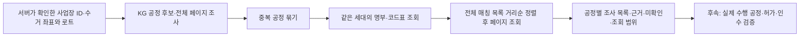

# PR를 확인하고 다음에 연결한 기능

2026-10-24 기준입니다. Re_ai PR **19개(병합 14개·열림 5개)**의 상태·본문·검토/CI·변경 파일·의존성을 확인했습니다.
열린 PR의 구현과 최근 병합된 RAG·LCI의 연결 지점을 확인하고 관련 검사를 실행했습니다.
과거 모든 변경 줄의 보안·추천 정확도 감사를 완료했다는 뜻은 아닙니다.
Re_server·Re_client·Re_infra·Re-Prototype·RE-Main에는 확인 당시 열린 PR가 없었습니다. 다른 레포의 전체 과거 PR를 검토한 것은 아닙니다.

## PR별 상태

링크의 상태는 이후 달라질 수 있습니다. 아래는 이번 점검 기록입니다.

| PR | 내용 | 이번 확인과 처리 |
| --- | --- | --- |
| [#2](https://github.com/resource-ai-team/Re_ai/pull/2) | Issue·PR 템플릿 | 병합됨. 후속 PR 본문에 같은 양식 사용 |
| [#3](https://github.com/resource-ai-team/Re_ai/pull/3) | 기본 레포 구조 | 병합됨 |
| [#5](https://github.com/resource-ai-team/Re_ai/pull/5) | 법령 Hybrid 검색·재정렬 | 병합됨. 현재 LAW 범위와 멀티 코퍼스 연결 확인 |
| [#7](https://github.com/resource-ai-team/Re_ai/pull/7) | Ruff CI | 병합됨. 형식·정적 검사 실행 |
| [#9](https://github.com/resource-ai-team/Re_ai/pull/9) | Neo4j KG·후보 검색 | 병합됨. 실제 Neo4j 회귀 검사 |
| [#11](https://github.com/resource-ai-team/Re_ai/pull/11) | 전체 후보 풀·조사 묶음 | 병합됨. 전체/부분 페이지 계약 유지 |
| [#13](https://github.com/resource-ai-team/Re_ai/pull/13) | 출처 기반 공정 경로 | 병합됨. 공정·단계 ID를 후속 연결에 사용 |
| [#15](https://github.com/resource-ai-team/Re_ai/pull/15) | 시설 명부 추가 조사 | 병합됨. 명부 조사와 공정 수행 입증을 구분 |
| [#17](https://github.com/resource-ai-team/Re_ai/pull/17) | 시설 공개 조건 대조 | 병합됨. 미확인을 적합으로 바꾸지 않음 |
| [#19](https://github.com/resource-ai-team/Re_ai/pull/19) | 후보 조사·비용/탄소 산술 | 병합됨. 실제 단가·계수 적용성 확인과 구분 |
| [#21](https://github.com/resource-ai-team/Re_ai/pull/21) | KG 근거·연결 보강 | 병합됨. 출처·조회 세대 대조 유지 |
| [#23](https://github.com/resource-ai-team/Re_ai/pull/23) | 개발용 그래프 탐색 화면 | 열림. develop과 충돌 상태. 동료 브랜치는 수정하지 않음. 서비스 3D 화면과 별도 |
| [#24](https://github.com/resource-ai-team/Re_ai/pull/24) | 법률 그래프·Researcher/Auditor | 열림. 최신 develop 반영·충돌 해결 후 푸시. 갱신 커밋 `1864bd7` CI 두 작업 통과 |
| [#26](https://github.com/resource-ai-team/Re_ai/pull/26) | KG-수치 연결·Critic·보고서 | 열림. #24와 최신 develop 반영 후 `91dd7cb` CI 통과. 이번 사업장별 시설 조사도 이 PR에 추가 |
| [#27](https://github.com/resource-ai-team/Re_ai/pull/27) | PET 국가 LCI 예비 산정 | 병합됨. 제한된 공정·경계 매핑이며 모든 시설의 실제 탄소값은 아님 |
| [#29](https://github.com/resource-ai-team/Re_ai/pull/29) | 플라스틱 5종 소각 LCI | 열림. 최신 develop 반영 후 `dee2bec` 푸시·CI 통과 |
| [#30](https://github.com/resource-ai-team/Re_ai/pull/30) | 실제 KG→LCI 매핑 API | 열림. 최신 develop 반영 후 `112fbfd` 푸시·CI 통과 |
| [#31](https://github.com/resource-ai-team/Re_ai/pull/31) | RAG 문서 적재 자동화 | 병합됨. 기존 개발 흐름에 유지 |
| [#33](https://github.com/resource-ai-team/Re_ai/pull/33) | 멀티 코퍼스·기술문헌 | 병합됨. 기업별 문서 격리와 법규 조사 LAW 필터 유지 |

최신 develop 기준은 `d7586c8`입니다. 위 갱신은 **PR 브랜치 갱신**이며 GitHub에서 병합한 것이 아닙니다.
#24 → #26 순서로 검토해야 합니다. #29·#30은 별도 PR이며 이번 #26 실행 결과에 포함됐다고 주장하지 않습니다.
CI 통과와 동료의 코드 승인·운영 배포는 서로 다릅니다.

## 다음 작업으로 실제 구현한 것

사용자 시나리오는 **내 사업장에서 나온 폐자원 → 가능한 공정 순서 → 각 공정 주변 시설 조사**입니다.
기존 시설 검색을 사람이 공정마다 따로 호출해야 했으므로 `/analysis/site-discovery`를 추가했습니다.

이는 최종 추천이 아닌 **조사 단계**입니다. 출발 사업장 변경을 해시에 반영하고,
조사 중 그래프·명부 버전이 달라지거나 페이지가 중복되면 섞인 결과를 반환하지 않습니다.
기존 관련도 정렬은 유지하고 새 거리 정렬을 별도로 추가했습니다.
실제 도로거리·가격·LCI 계산·법규 검색·생성 모델 호출은 이 새 API에서 실행하지 않습니다.
[입출력과 실행 기록](site-discovery-api.md)을 참고하세요.

## 실제 명부로 돌려 보니

가상 사업장 좌표·검정 PP 3톤을 **실제 활성 Neo4j KG와 명부**로 조회했습니다.

- KG 경로 3개, 서로 다른 공정 4개, 명부 등록 레코드 9,604개.
- 공정마다 2,355개의 조사 단서가 매칭됐고 시연 한도로 처음 3개만 조회했습니다. 부분 조회를 응답에 표시했습니다.
- 직선거리 0.6·0.8·0.9km의 같은 가까운 레코드가 네 공정에 모두 나타났습니다.
- 넓은 폐합성수지 분류와 미해석 코드도 포함돼 있습니다. 각 업체의 세척·압출 수행 능력을 확인한 결과가 아닙니다.
- 모든 결과는 REVIEW이며 인수·발주 승인이나 최종 추천은 없습니다.

**다음 병목은 시설의 실제 공정·투입 조건 자료입니다.** 거리 계산을 붙였다는 이유만으로 이 문제를 해결했다고 할 수 없습니다.
원시 업체명·주소는 Git에 넣지 않고 [검사 기록](evaluation/site-discovery-2026-10-24.json)에 등록 ID·거리·근거 유형·조회 범위만 남겼습니다.

## 검증 범위

이번 #26 작업 브랜치에서 실제 PostgreSQL·별도 Neo4j를 활성화한 전체 검사:
**609개 통과·24 subtest 통과·1개 skip**. skip은 로컬에 없는 사용 조건 제한 LCI 원본 파일 검사입니다.
새 기능의 실제 Neo4j 검사 2개가 이 결과에 포함됩니다. 생성 모델 호출은 하지 않았습니다.
Ruff·format, 문서 링크, 번들 SHA-256, staged 비밀값 패턴도 확인합니다.

앞선 10월 22일의 검색 품질 회귀 6/7 기록은 보존합니다. 이번 코드 테스트 통과가 해당 법규 질문의 회수 품질·적용성 개선을 입증하는 것은 아닙니다.
#29·#30의 개별 CI와 이번 브랜치 검사는 구분하며 미병합 PR 전체의 조합을 검증 완료한 것은 아닙니다.

## 팀이 이어서 할 순서

| 순서 | 데이터에서 필요한 것 | 기술에서 필요한 것 | 완료 판단 |
| --- | --- | --- | --- |
| 1. 공정별 시설 검증 | 대상 시설의 실제 수행 공정·투입 성상/등급·제외 조건·출처/기준일 | 등록 ID→실제 사업장 식별, 조건 대조, 미확인 보존 | 같은 PP라도 파쇄·세척·압출의 확인 상태가 자료에 따라 달라짐 |
| 2. 사업장 연결 | 회원 기업·사업장·확인된 수거 게이트 | Re_server 권한 검증·Re_client 사업장 선택·새 API 연결 | 다른 기업 사업장 접근 차단, 사업장 변경 시 옛 조사 표시 해제 |
| 3. 허가·인수 검증 | 현행 허가 범위·물량/시기별 수용 조건·응답 | 법령 근거와 시설 자료를 같은 로트에 연결 | 미확인을 허가·인수 승인으로 표시하지 않음 |
| 4. 실제 운송·견적 | 구간별 도로거리·처리/운송 견적·유효기간 | 지도 어댑터·다중 구간·사업장/로트/경로 수치 바인딩 | 시설 사이 구간을 포함하고 주소·물량 변경 시 재계산 |
| 5. 비용·탄소·출력 | 같은 물량·경계의 활동량·적용 가능한 LCI·실제 단가 | #29/#30 검토·기존 계산/독립 Critic 연결·시각화 | 근거가 있는 수치만 비교, 부족하면 REVIEW 유지 |

시설 자료가 없을 때 모델이 능력·단가를 만들어 채우지 않습니다.
모델 연결은 사용자 요청에 따라 후속이며, 자동 재실행·영구 이력·PASS·최종 Top K도 아직 남아 있습니다.
