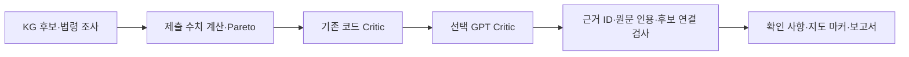

# GPT Critic: 근거를 읽고 추가 확인 사항 제안

기존 코드 검사를 실행한 다음, **Azure GPT-6 Astra / high**가 전체 후보·법령 인용·제출 수치를 읽고 놓친 조건을 지적하는 선택 단계를 추가했습니다. 현재는 연결·출력 검증 구현과 모의 Azure 전송 시험까지 완료했습니다. **이번 기능의 실제 GPT 추론 정확도는 아직 검증하지 않았습니다.**

## 어디에 들어가나요?



`/analysis/review`는 조사·수치 검토 뒤에 호출합니다. `/analysis/site-review`는 시설 조사와 LCI 예비 산정도 끝낸 뒤에 한 번 호출합니다. 이때 LCI 원본이나 업체 명부를 통째로 전달하지 않습니다.

| 담당 | 역할 |
| --- | --- |
| 코드 Critic | 기존 경로·로트·사업장·단위·산술·비교·버전 검사 |
| GPT Critic | 제공된 자료의 예외·조건·비용 누락·탄소 경계·과장된 결론에 대한 추가 반박 제안 |
| 코드 검수 | 인용이 실제 제공 문구와 맞는지, 근거 ID와 후보·단계가 존재하고 연결되는지 검사 |
| Router | 기존 코드 오류는 REVISE, 모델 제안은 확인 사항으로 REVIEW에 남김. PASS·인수 승인 없음 |

**인용이 맞다는 사실과 반박 내용이 옳다는 사실은 다릅니다.** 원문 인용 검사를 통과해도 모델 제안의 의미적·법적 정확도는 별도 평가가 필요합니다. GPT의 `potential_error`도 확인된 오류로 자동 승격하지 않습니다. 원래 오류·후보·계산 결과를 지우지 않습니다.

## 실제로 구현한 것

- 요청당 최대 1회, Astra/high 고정, 자동 재시도·Solar 대체·웹 검색·도구 실행 없음.
- 모든 후보의 경로 정보를 넣습니다. 후보를 일부 잘라 조사를 완료한 것처럼 표시하지 않습니다.
- 최대 600개 근거 레코드·입력 120,000자·기본 출력 8,192토큰. 한도 초과 시 호출하지 않고 표시합니다.
- 출력은 구조화 JSON이며 제안 최대 20개, 요청 기본 12개입니다. 최대 개수에 도달했는지도 기록합니다.
- 모델이 만든 근거 ID·틀린 인용·다른 후보 자료·존재하지 않는 단계·HTML/외부 링크를 기각합니다.
- 유효한 제안과 기각된 제안이 섞이면 `partial`로 남깁니다. 빈 제안은 안전·적법·검토 완전성을 뜻하지 않습니다.
- 공급자 장애·잘못된 JSON·입력 한도·전송 차단은 상태로 드러내며 기존 코드 검사 결과는 반환합니다.
- 서비스 토큰은 Re_server → AI 엔진 전용입니다. 모델 키·배포명·전송 허용은 서버 설정으로만 관리합니다.

## 어떤 값이 Azure에 전달되나요?

서버의 `SEMANTIC_CRITIC_ALLOW_EXTERNAL=true`는 아래 **구조화 값과 허용 법령 구간** 전송을 허용하는 설정입니다. 모델 사용자가 요청 JSON에 전송 정책이나 API 키를 넣어 우회할 수 없습니다.

| 전달 | 내용 |
| --- | --- |
| 구조화 로트 | 소재·형태·물량·수분율·오염률·지정폐기물 여부 |
| 후보 | 엔진 후보/단계/인계 ID·공정명·공개 조건 대조 상태. 실제 수행·인수가 확인됐다는 의미 아님 |
| 수치 | 비교에 연결된 제출 활동량·계수·단위·물량·기준일·지역·탄소 방법·계산 경계·수치상 Pareto. 비교 제외 수치는 값 대신 제외 상태만 전달 |
| 코드 검사 | 오류/누락 코드·단계·후보·대상 ID. 모델 의견을 기존 사실로 넣지 않음 |
| 법령 | 현재 조회된 공식 LAW 구간의 본문·법명·조문·버전·시행일·공식 URL. 모델에는 생성한 E#### 참조 별칭 사용 |
| 조사 범위 | 법령 문맥 미완료 수·제외 자료 수·시설/LCI 조회 건수·예비값을 총계에 합산하지 않았다는 표시 |

**전달하지 않는 값:** 기업/공장명·회원 ID·주소·좌표·입력 메모·업체 명부 행·업체 원본·기업 업로드 문서·숫자 근거의 비공개 URL/문서·사용 제한 LCI 원문/계수·도로 geometry. 현재 기술문헌과 판례도 외부 전송 권한을 확인할 경로가 없어 본문 전송에서 제외합니다. 제외 건수는 표시합니다.

구조화된 물량·지역·공정 조건도 기업 고유 정보일 수 있습니다. 이 처리는 직접 식별자를 줄이는 것이며 완전한 익명화 보장이 아닙니다. 수치 근거 문서 자체를 보내지 않으므로 원본 가격의 진위를 GPT가 검증했다고 표시하지 않습니다.

## 설정과 요청

기존 Azure endpoint·key·배포 설정을 재사용합니다. 새 Azure 리소스는 만들지 않습니다. 기본은 비활성 상태이며 `.env`의 기존 법률 그래프 설정과 독립적입니다.

```dotenv
SEMANTIC_CRITIC_ENABLED=true
SEMANTIC_CRITIC_ALLOW_EXTERNAL=true
SEMANTIC_CRITIC_SERVICE_TOKEN=<백엔드와_엔진만_아는_별도_토큰>
SEMANTIC_CRITIC_TIMEOUT_SECONDS=120
SEMANTIC_CRITIC_MAX_INPUT_CHARS=120000
SEMANTIC_CRITIC_MAX_OUTPUT_TOKENS=8192

AZURE_OPENAI_DEPLOYMENT_MODEL=gpt-6-astra
AZURE_OPENAI_REASONING_EFFORT=high
```

이 설정은 실제 Azure 호출·과금과 위 표의 데이터 전송을 활성화합니다. 브라우저에 서비스 토큰·모델 키를 제공하면 안 됩니다. 이 작업에서는 실제 로컬 전송 허용을 켜지 않았고 유료 모델 호출을 하지 않았습니다.

기존 요청에 `semantic_critic`을 추가하고 **`X-Critic-Service-Token` 헤더**를 전달합니다. 도로 API의 Authorization 헤더와 별도라 함께 쓸 수 있습니다.

```json
{
  "research": {
    "lot": {"material": "PP", "input_form": "scrap", "quantity_kg": 3000},
    "max_legal_queries": 1,
    "max_technical_queries": 1
  },
  "semantic_critic": {"max_findings": 4}
}
```

위 예시는 `POST /analysis/review`입니다. `POST /analysis/site-review`도 기존 요청에 같은 `semantic_critic` 옵션을 추가합니다. 옵션 생략 시 모델 호출이 없습니다. 요청했는데 설정이 꺼졌으면 결과의 실행 상태와 미완료 확인 사항에 표시합니다. 호출 가능한 서버 설정에서 서비스 토큰이 없거나 틀리면 401, 서버 토큰 미설정은 503입니다.

## 응답과 화면 연결

- `semantic_critic.status`: `completed`, `partial`, `invalid_output`, `unavailable`, `disabled`, `external_transfer_disabled`, `not_configured`, `context_budget_exceeded`, `evidence_conflict`, `no_candidates`, `not_requested`.
- `findings`: 후보·대상·반박·다음 행동·실제 인용·원래 근거 ID. `semantic_correctness_verified=false` 유지.
- `rejected_findings`: 응답 내 순번·기각 사유 코드. 기각된 원문·주장을 화면에 리스크로 올리지 않음.
- `coverage`: 전체 후보 포함 여부·제외 자료·한도·추가 조사 범위. 의미적 검토 완료율을 뜻하지 않음.
- `model_calls`, `usage`, `input_sha256`: 호출 시도 수·제공자가 반환한 토큰 수·입력 확인값. 실패 시 사용량은 없을 수 있음.
- `critic[].origin`과 `map_markers[].origin`: `code` / `model_concern` 구분. `semantic_finding_id`로 상세 인용에 연결.
- 모델 제안도 기존 지도 마커·그룹·보고서에 들어갑니다. 실제 3D UI가 이 필드를 받아 표시하는 작업은 별도입니다.

요청·모델 원문·비밀값·숨은 추론을 새 영구 로그나 DB에 저장하지 않습니다. 처리 중 메모리에 자료와 응답이 있고, API 응답에는 채택한 제안·인용·상태가 포함됩니다. Azure 요청은 `store=false`이며 Azure 자체 운영 로그의 보관까지 없다는 보장이 아닙니다.

## 검증 결과와 남은 조건

가상 PP 3톤을 실제 로컬 Neo4j·PostgreSQL·보유 LCI로 처리하고, **Azure 전송만 모의 응답**으로 시험했습니다. 전체 연결 검사 5개와 잘못된 근거·인용·대상·모델 판정·429·빈 답변·예산·전송 차단 등 11개 사례가 통과했습니다. [기록](evaluation/semantic-critic-contract-2026-10-26.json)

실제 DB를 켠 전체 코드 테스트는 **840개 + subtest 24개 통과, skip 0개**입니다. 새 Critic 단위 검사는 27개이며, 실제 모델의 추론 품질 점수를 뜻하지 않습니다. [코드 테스트](evaluation/semantic-critic-tests-2026-10-26.json)

이 사례의 모델 입력은 **100,196자**였습니다. 현재 Azure 배포 기록은 1,000 TPM·분당 1요청이라 전체 근거 Critic의 실사용 할당량·입력/출력 예산 검토가 필요합니다. 기존의 짧은 합성 Azure 연결 성공을 이번 긴 입력 성공으로 간주하지 않습니다.

다음 검증은 오류를 심은 실제 공정·법령 질문에 대해 GPT의 오류 발견율·오탐률·인용 적합성을 사람이 평가하는 것입니다. 모의 출력은 이 추론 품질을 측정하지 않습니다. PR #51의 KG–Technical RAG 근거 검증은 확인했으며 아직 병합되지 않아 그 상태를 GPT가 검증한 것으로 포함하지 않습니다.
