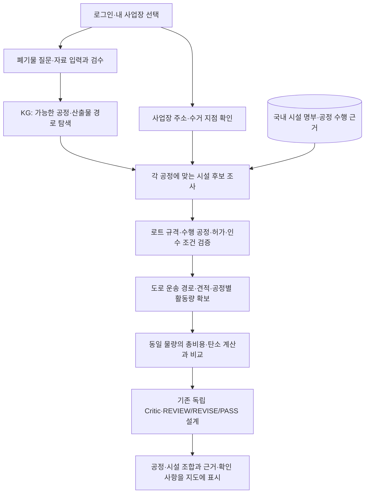

# 배출 사업장을 출발점으로 하는 공정·시설 탐색

2026-10-22 사용자 논의에 따른 설계 방향입니다. **사업장 선택·도로 경로·견적 연동을 구현했다는 문서는 아닙니다.**
현재 비용·탄소·Critic 파이프라인을 유지하면서 입력과 시설 탐색 사이의 연결을 보강합니다.

2026-10-24 추가: **사업장 좌표→KG 공정→시설 명부 조사**는 새 내부 `/analysis/site-discovery`로 구현했습니다.
회원의 사업장 선택 화면·권한 검증, 실제 도로 경로·견적·최종 추천은 여전히 후속입니다.
[실행 계약과 실제 명부 검사](site-discovery-api.md)를 참고하세요. 아래 전체 흐름은 목표 설계입니다.

## 사용자가 하는 일

> 나는 SK 반도체 사업장 연구원이다. 이 사업장에서 이런 폐기물이 발생했다. 어떻게 처리하면 좋을까?

회사 이름만으로 출발 사업장을 확정하지 않습니다. SK하이닉스를 예로 들면 공식 자료에도
[이천·청주 캠퍼스 등이 따로 소개](https://talent.skhynix.com/hub/ko/company/campus)됩니다.
사업장·수거 지점이 달라지면 조사할 시설·운송 구간·비용도 달라집니다.
어느 반도체 기업의 어느 사업장인지와 폐기물 종류는 각각 확인하며, 업종만 보고 PP나 지정폐기물 여부를 추정하지 않습니다.

회원의 소속 기업과 사업장은 Re_server의 업무 정보로 등록하고 기본 사업장을 선택하게 합니다.
매번 프롬프트에 회사 주소를 쓰게 하지 않습니다. 기본값이 없거나 여러 사업장이 언급되면 필요한 선택만 요청합니다.
초기 MVP에는 전 세계 공장 DB가 필요하지 않습니다. 사용할 기업이 자기 사업장을 등록하는 것으로 시작할 수 있습니다.

| 입력 | 필요한 이유 |
| --- | --- |
| 소속 기업·선택 사업장 ID | 회사 이름과 개별 사업장을 구분하고 회원의 접근 권한 적용 |
| 확인된 주소·수거 게이트 좌표 | 실제 출발지. 본사 주소나 캠퍼스 중심점을 자동으로 수거 지점으로 확정하지 않음 |
| 폐기물 성분·형태·양·발생 공정·분석 자료 | 가능한 공정과 수탁 조건의 판단 근거 |
| 발생 주기·물량·시기 | 시설 수용·배차·단가 조건 확인 |

사용자가 소속되었다는 예시와 그 기업이 실제 폐기물을 제공·서비스를 사용했다는 주장을 구분합니다.
실제 반도체 폐자원이 KG 지원 범위 밖이면 미지원·추가 조사로 남깁니다.

## 전체 처리 흐름

기존 PASS·최종 추천 게이트는 목표 설계이며 현재 검토 API는 REVIEW/REVISE만 반환합니다.
공정 KG에는 가능한 기술 순서가, 시설 DB에는 그 공정을 수행할 수 있는지 조사할 개별 사업장이 들어갑니다.
두 자료를 연결해 선택한 배출 사업장에서 출발하는 후보를 구성해야 합니다.

기존 예제의 중앙이엔비→BGF 연결을 모든 사용자의 고정 경로로 사용하지 않습니다.
처리시설과 재생원료를 사용하는 제조 사업장은 후보 유형을 구분해 다른 수행·투입·법규 조건을 확인합니다.
명부 레코드는 탐색 단서이며 미확인 시설을 검증된 공정 수행처로 자동 승격하지 않습니다.

## 거리·가격은 어떻게 비교하나

| 기준 | 계산·표시 원칙 |
| --- | --- |
| 처리 적합성 | 명시적 불일치는 사유와 함께 분리. 근거가 부족한 후보는 확인 필요로 보존 |
| 근접성 | 직선거리는 후보 조사 순서의 참고값. 실제 도로거리와 분리 |
| 도로거리 | 확인된 출발·도착 지점으로 구간별 경로 조회. 다른 시설을 거치면 전체 구간을 합산 |
| 비용 | 같은 물량·시점의 전처리·처리·운송·잔재물 비용에서 매각 수익을 뺌. 검사·보관 등 필요한 부대 조건도 확인 |
| 탄소 | 같은 기능단위·경계의 공정·운송·잔재물 활동량과 적용 가능한 계수 사용 |
| 정렬 | 비교 가능한 후보의 거리·총비용 등을 각각 정렬. 미확인 비용을 0으로 넣거나 임의 종합 점수로 단일 최적을 단정하지 않음 |

출발 공장에서 첫 시설까지의 거리만으로 여러 공정을 거치는 경로를 비교하지 않습니다.
세척·압출 등을 한 시설에서 수행하는 경우도 구간·설비 경계를 확인해 중복 운송비를 넣지 않습니다.
가까운 시설만 사전에 남겨 원거리의 더 적합하거나 총비용이 낮은 후보를 누락하지 않도록 탐색 범위·한도도 표시합니다.

[Naver Directions 15](https://api.ncloud-docs.com/docs/application-maps-directions15)는 자동차 경로의 거리·시간·통행 요금 등을 반환합니다.
문서상 차종 옵션은 통행 요금 계산에 사용되며 차량 중량·크기를 판단하지 않습니다.
따라서 도로거리 조회가 특수 화물의 실제 운행 가능성 확인이나 운송사의 화물 운임 견적을 대신하지 않습니다.
이번 설계 검토에서 유료 API를 호출하거나 새 키·계정을 만들지 않았습니다.

## 사용자 화면

화면 상단에 **현재 기업 / 출발 사업장 / 폐기물 로트**를 계속 보여 줍니다.
사업장을 바꾸면 그 사업장에서 출발하는 후보와 운송·비용을 다시 검토합니다.
기존 로트·그래프 바인딩처럼 사업장과 수거 지점의 변경도 예전 수치의 재사용을 막아야 합니다.

경로 카드에는 다음 정보를 함께 표시합니다.

- 공정 순서와 산출물, 각 시설의 실제 식별 정보
- 전체 도로거리와 구간별 거리, 조회 기준·시각
- 실제 견적이 있을 때의 총비용, 없을 때의 견적 미확보 표시
- 사업장별 수행 공정·허가·투입 규격·이번 로트 인수의 확인 상태
- 공정·인계 구간의 확인 과제와 다음 행동

3D 월드에도 선택한 사업장을 출발점으로 두고 검토 중인 목적지·인계 경로를 연결합니다.
그림의 상징적 배치와 실제 좌표·도로거리 데이터를 구분하며, 가격·인수 상태가 없는 곳을 추천 완료로 표시하지 않습니다.

## 지금 가능한 것과 다음 구현

| 기능 | 현재 상태 | 보강할 것 |
| --- | --- | --- |
| 회사·출발 사업장 선택 | Re_ai에 사업장 ID·주소·좌표 입력 계약 추가 | Re_server 회원 권한·기본 사업장·수거 지점 확인, 선택 화면 연동 |
| 소재별 공정 경로 | 등록 KG 범위에서 가능 | 지원 소재·공정·시설 수행 근거 확장 |
| 시설 명부 조사 | `/analysis/site-discovery`에서 KG 공정별 명부 조회 연결 | 시설의 실제 수행 공정·투입 규격 확인 후 검토 흐름에 연결 |
| 위치 기반 검색 | 출발 좌표 기준 직선거리순 정렬·페이지 조회 | 주소 정규화·좌표 검수·도로 경로 |
| 도로 경로 | 미연결 | 지도 API 어댑터·근거/조회시각·다중 구간 비교 |
| 가격순 비교 | 제출 수치의 계산 가능 | 실제 견적·활동량·운송비와 사업장/로트 적용성 검수 |
| 사업장별 최종 경로 | 고정 참조 연결과 별도 명부 후보가 분리됨 | 시설 식별·공정 근거 검수 후 경로 구성, 원인별 Critic·이력 연동 |

명부 검색의 기본 순서는 **설비 단어 → 소재 단서 → 직선거리**로 유지합니다.
새 사업장 조사 API는 별도 `straight_line_distance` 정렬을 사용하며, 거리순 최종 추천이 아니라 조사 순서입니다.
입력의 `region`만으로 출발 공장의 위치·게이트가 정해지지 않으며 현재 `/analysis/review`에는 구조화된 출발 사업장 계약이 없습니다.
[현재 시설 탐색 계약](kg-facility-matching.md)과 [현재 검토 계약](grounded-decision-review.md)을 유지하고 새 계약은 서버 담당자 검토 후 연결합니다.

다음 작업은 **사업장 권한·화면 연동 → 시설 수행 공정·허가·인수 근거 → 도로거리 → 실제 견적 비교** 순서로 진행합니다.
회사·사업장 프로필과 폐자원 성상은 사용자/문서가 확인하고, LLM은 누락 정보 추출과 근거 조사에 사용합니다.
거리 계산·숫자 비교·사업장 권한·상태 무효화는 코드가 담당합니다.
